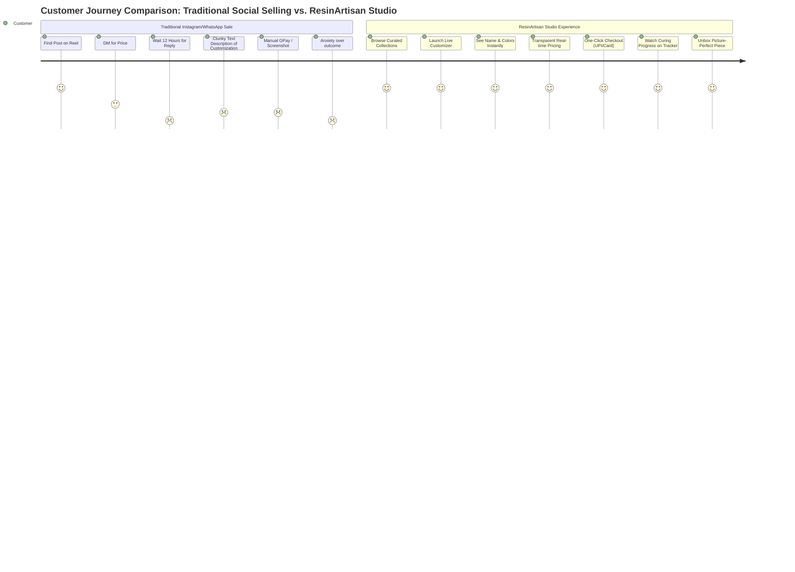
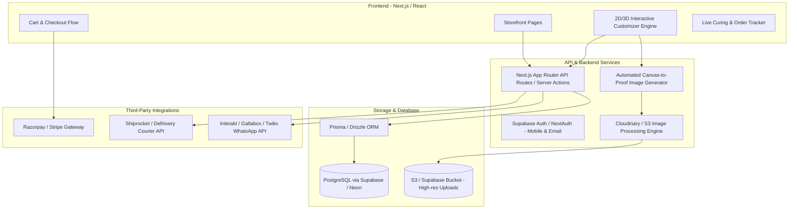
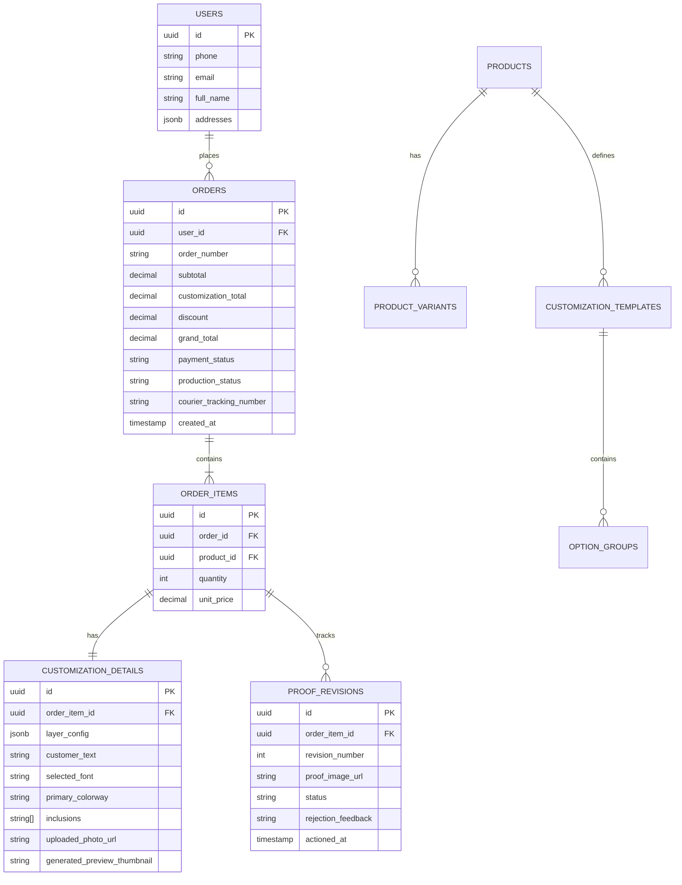

# BMad Brainstorming & Product Specification
## Artआलय — Custom Resin E-Commerce Platform

**Brand Name:** **Artआलय** (English *Art* + Devanagari *आलय*)  
**English Slug:** `artaalay`  
**Document Version:** 1.1.0  
**Methodology:** BMad Agile Ideation & Product Discovery (Divergent Brainstorming, JTBD, SCAMPER, Technical Modeling)  
**Target Domain:** Custom Handcrafted Resin Products & D2C E-Commerce (India Market)  
**Tech Stack Focus:** React / Next.js, Interactive Konva.js 2D Canvas Customizer, Tailored Order & Curing Management  

---

## 1. Executive Summary & Product Vision

### 1.1 The Core Problem
Handmade resin decor and gifting products are booming across social channels (Instagram, Pinterest, Etsy). Customers love them because epoxy resin allows stunning visual effects: crystal-clear encapsulation, metallic mica swirls, botanical flower preservation, and ocean wave effects.

However, the current buying and selling experience is broken:
- **Friction-Heavy Buying via DMs:** Sellers spend hours in WhatsApp/Instagram chats exchanging fonts, color photos, and payment screenshots.
- **Buyer Hesitation & Imagination Gap:** Customers cannot visualize how their name will look in gold acrylic on an ocean-blue resin clock or what dried flowers look like inside a bookmark.
- **Disputed Expectations:** Because handmade resin has natural curing characteristics (micro-bubbles, fluid pigment movement), customers often dispute the end result without clear digital proofs or guidelines.
- **Production Chaos for the Artisan:** Resin requires exact mixing ratios, temperature control, and 24 to 72 hours of curing. Tracking which order is poured, curing, demolded, or packaged is currently done on loose paper or messy spreadsheets.

### 1.2 The Vision
**"Artआलय"** is an experiential, React-based direct-to-consumer (D2C) e-commerce platform that bridges the gap between digital customization and physical handcrafted resin art. 

It empowers customers to:
1. **Visually configure** bespoke resin items in real time (colors, inclusions, typography, base materials, hardware).
2. **Preview accurately** with layered 2D visualizers before paying.
3. **Approve digital production proofs** seamlessly via WhatsApp / web portal.
4. **Track the artisan crafting journey** through an engaging "Curing & Crafting" live timeline rather than generic shipping statuses.

---

## 2. BMad Divergent Ideation Streams

Using the BMad Brainstorming library techniques, we explored multiple facets of the business, customer psychology, physical resin limitations, and technology.

### 2.1 First Principles Thinking (Deconstructing the Resin Object)
By breaking a resin artifact down into its fundamental physical layers, we define the exact data model and customizer UI:

```
┌────────────────────────────────────────────────────────┐
│ [Layer 5: Hardware & Mounting]                         │
│ Keyrings, Tassels, Silent Quartz Clock, 3M Dash Pad    │
├────────────────────────────────────────────────────────┤
│ [Layer 4: Personalization & Surface Text]              │
│ 3D Acrylic Mirror Letters, Vinyl Decal, Foil Stamping  │
├────────────────────────────────────────────────────────┤
│ [Layer 3: Inclusions & Embeds]                         │
│ Gold Flakes, Dried Flowers, Crystals, Photo Prints     │
├────────────────────────────────────────────────────────┤
│ [Layer 2: Resin & Pigment Matrix]                      │
│ Crystal Clear, Metallic Mica Swirl, Ocean Foam, Geode  │
├────────────────────────────────────────────────────────┤
│ [Layer 1: Base & Mold Foundation]                      │
│ Raw Teak Wood, Acrylic Sheet, Silicone Mold Geometry   │
└────────────────────────────────────────────────────────┘
```

- **Insight:** Because resin products are literally made in physical pours/layers, the digital customizer should mirror physical layering! Customers choose:
  1. Base Shape / Wood Cut
  2. Background Tint & Pour Pattern
  3. Inclusions (botanicals, glitters, stones, customer photo)
  4. Foreground Typography (names, dates, house numbers, mantras)
  5. Functional Hardware (chains, clasps, clock needles, LED backlights).

---

### 2.2 SCAMPER Exploration (Product Innovation)

| SCAMPER Lens | Brainstormed Concept | Value / Market Appeal |
| :--- | :--- | :--- |
| **Substitute** | Substitute cardboard gift boxes with a reusable, laser-engraved acrylic box with resin accents. | High-end gifting premium; unboxing experience designed for Instagram reels. |
| **Combine** | Combine resin wall clocks with subtle warm LED backlighting and geode raw crystals. | Transforms a simple functional clock into high-ticket statement wall art (\$60–\$150). |
| **Combine** | Combine car dashboard idols with integrated fragrance stone reservoirs / essential oil diffusers. | Combines spiritual blessings with practical car air-freshening. |
| **Adapt** | Adapt the "Nike By You" / "Canva" drag-and-drop layer model for resin nameplates and coasters. | No artistic skill required from customer; provides instant gratification and zero checkout hesitation. |
| **Modify / Magnify** | **"Eternal Varmala / Memorial Preservation Service"**: Customers book a preservation kit, ship their wedding garland/pet memorial, and receive a luxury resin block or clock. | High emotion, high margin (₹4,000–₹15,000 / \$60–\$200+ per order). |
| **Put to Other Use** | **Multi-purpose Festive Decor**: Shubh Labh & Toran sets with magnetic or convertible attachments that work on doors during Diwali and as wall/pooja accents year-round. | Year-round utility; solves the problem of seasonal decorations being packed away. |
| **Eliminate** | Eliminate the 20-message WhatsApp design consultation; eliminate vague font previews. | 80% reduction in customer acquisition time per order for the artisan. |
| **Reverse** | **"Aesthetic Room Matcher" Quiz**: Customer uploads a photo of their wall or entryway, and the AI matches complimentary resin pigment schemes and shapes. | Turns browsing into personalized interior styling consultation. |

---

### 2.3 Jobs-To-Be-Done (JTBD) & Customer Archetypes



#### Archetype 1: "The Housewarming & Festival Decorator" (Pooja, 32)
- **Need:** Moving into a new apartment or preparing for Diwali/Griha Pravesh.
- **Products:** Custom Name Plate (Teakwood + Ocean Wave + Brass/Gold Acrylic), Toran for entrance, Shubh Labh for mandir, Agate Resin Wall Clock.
- **Trigger:** Wants welcoming, auspicious, aesthetic accents that guests notice immediately.
- **JTBD:** *"Help me make my home entrance feel blessed, modern, and uniquely ours without looking cheap or generic."*

#### Archetype 2: "The Meaningful Gifter" (Rahul, 26)
- **Need:** Birthday, anniversary, or Raksha Bandhan gift for partner/sister.
- **Products:** Floral resin bookmark, initial letter keyring with gold flakes, ocean drop earrings, photo-encapsulated resin block.
- **Trigger:** Sick of gifting chocolates, mugs, or fast-fashion gift cards; wants something customized with their name/photo.
- **JTBD:** *"Give me a memorable, personalized gift that arrives beautifully boxed with a handwritten note in under 7 days."*

#### Archetype 3: "The Daily Commuter & Car Enthusiast" (Aman, 29)
- **Need:** Protective and spiritual dashboard accent for a new car.
- **Products:** Resin Car Dashboard Idol (Lord Ganesha, Mahadev, Ik Onkar, Evil Eye, Hanuman) with anti-skid pad and ambient translucent glow.
- **JTBD:** *"Provide an elegant, modern spiritual presence in my vehicle that stays fixed during driving and catches the sunlight beautifully."*

#### Archetype 4: "The Sentimental Milestones Preserver" (Ananya & Rohit, 28)
- **Need:** Preserving wedding varmala flowers or first baby ultrasound / newborn curls.
- **Products:** 10" Hexagon Resin Keepsake Block, Deep Shadow Box Clock with embedded dried petals.
- **JTBD:** *"Permanently freeze our most cherished, perishable memories in crystalline glass-like resin forever."*

---

### 2.4 Reverse Brainstorming & Risk Inversion

We brainstormed: *"How could a customized resin website fail miserably?"* and inverted every failure mode into a core defensive feature:

| Failure Mode | Root Cause | Preventive Feature Engineered in the App |
| :--- | :--- | :--- |
| **"It looks nothing like the picture!"** | Digital hex colors look different from chemical resin pigments; swirl patterns are organic, not vector graphics. | **"The Artisan Nature Disclaimer" & Dynamic Texture Engine**: Instead of flat vector fills, use high-resolution photographic texture maps of real cured resin with a tooltip: *"Hand-poured resin creates organic, one-of-a-kind swirls."* |
| **"Where is my order? Amazon delivers in 24 hours!"** | Resin takes 24–48 hours to cure per layer; custom goods take 5–10 days. Customers panic and cancel. | **"Artisan Studio Curing Tracker"**: A visual progress bar on the order status page: `[Design Validated] ➔ [Mold Prepped] ➔ [Resin Poured] ➔ [Curing in Chamber (36h)] ➔ [Sanding & Detailing] ➔ [Quality Check] ➔ [Packed & Dispatched]`. |
| **"Customer uploaded a 200x200 pixel blurry screenshot for a 12-inch photo clock."** | Unrestricted image upload input without dimension/DPI checks. | **Smart Image Preflight**: Auto-detect resolution; display green/yellow/red quality meter; aspect-ratio cropping tool on the canvas. |
| **"The resin piece cracked or arrived with scratches."** | Fragile demolding, bad courier handling, or uncured soft resin. | **Packaging Architecture**: Scratch-guard protective film on mirror acrylic, custom bubble-pocket boxes, and automated partnership with fragile-item couriers via Shiprocket. |
| **"Customer wanted font cursive, got bold serif, disputes payment."** | Verbal or ambiguous order notes. | **Mandatory Digital Proof Sign-off**: Before the resin is poured, the system generates a 1-click proof card sent via WhatsApp/email. Customer clicks `[Approve Proof]` or `[Request 1 Change]`. |

---

## 3. Product Range & Customization Matrix

The website will support 5 distinct product clusters, each with specific customizable parameters:

```
                          ┌─────────────────────────────┐
                          │   RESIN PRODUCT SPECTRUM    │
                          └──────────────┬──────────────┘
         ┌──────────────────┬────────────┴───────┬───────────────────┐
         ▼                  ▼                    ▼                   ▼
  [Pocket & Wearable] [Home Statement]  [Spiritual/Festive]  [Preservation]
  • Alphabet Keyrings • Wall Clocks      • Door Torans        • Varmala Keepsake
  • Floral Bookmarks  • Entry Nameplates • Shubh Labh Sets    • Memorial Blocks
  • Studs & Dangles   • Geode Coasters   • Car Dashboard Idols• Baby Milestones
```

### Detailed Customization Parameters by Product Category

| Category | Typical Products | Base Dimensions | Customizable Attributes | Hardware Options | Price Range |
| :--- | :--- | :--- | :--- | :--- | :--- |
| **1. Pocket & Stationery** | Initial Keyrings, Photo Keyrings, Floral Bookmarks, Spotify Code Tags | 4–6 cm (Keyrings), 14x3 cm (Bookmarks) | Initial letter, name text, foil flakes (Gold / Silver / Rose Gold), dried floral colors (Pink / Blue / White / Yellow / Lavender), tassel color. | Lobster clasp, keyring with chain, silk tassel, pom-pom charm. | ₹199 – ₹499 ($5 – $12) |
| **2. Jewelry & Wearables** | Stud Earrings, Drop Dangles, Ocean Pendants, Hairpins | 1–3 cm | Base shape (Round, Tear, Hexagon), resin tint (translucent, marble shimmer, ocean wave), embedded glitter / gold leaf. | 925 Silver posts, Stainless Steel, Hypoallergenic Gold-plated hooks. | ₹299 – ₹799 ($7 – $18) |
| **3. Spiritual & Auspicious Decor** | Torans (Door Hangings), Shubh Labh Sets, Car Dashboard Accents | Toran: 36"–42", Shubh Labh: 4"–6" each, Dash: 2.5"–3.5" | Background color (Deep Maroon, Emerald Green, Royal Blue, Pearlescent White), deity / symbol motif (Ganesh, Lakshmi, Swastik, Om, Ik Onkar), pearl/bead stringing style, adhesive base. | Hanging brass ring, 3M VHB automotive mounting tape. | ₹499 – ₹2,499 ($12 – $55) |
| **4. Statement Home Decor** | Custom Nameplates (House/Office), Geode Wall Clocks, Ocean Serving Trays | Plates: 12"x8" to 18"x12", Clocks: 12", 15", 18", 24" | Base material (MDF, Raw Teakwood, Clear Acrylic), resin wave colorways, 3D raised letters (Mirror Gold, Rose Gold, Gloss Black, Silver), LED backlight toggle, clock numerals (Roman, Minimalist, Sanskrit, Dots). | Wall mounting brackets, silent sweep quartz motor (sweep second hand), LED 12V adapter. | ₹1,499 – ₹8,999 ($35 – $200+) |
| **5. Keepsake Preservation** | Varmala Flower Casting, Milestone Cube, Resin Photo Frames | 6"x6" to 12"x12" blocks | Flower drying service option, arrangement style (Cascade, Geometric, Halo), custom brass plaque text, photo embed. | Solid wooden light base with USB LED warm light. | ₹3,499 – ₹14,999 ($80 – $350+) |

---

## 4. User Stories & Acceptance Criteria

### Epic 1: Interactive Product Customizer
- **US-1.1 (Live Text & Font Preview):** As a customer, I want to type my name/house number and choose from curated fonts, so that I can immediately see how the lettering looks against the resin backdrop.
  - *Acceptance Criteria:* Real-time canvas rendering; auto-centering; character limit check based on product dimensions; font preview rendered in selected material (e.g., Gold Mirror Acrylic).
- **US-1.2 (Resin Colorway & Inclusions Selector):** As a customer, I want to select background pigments (Ocean Wave, Emerald Geode, Classic Marble) and inclusions (Gold Foil, Dried Pressed Botanicals), so that the preview dynamically updates its texture.
  - *Acceptance Criteria:* Smooth layer toggling; preview updates in <100ms; realistic blend modes (CSS `mix-blend-mode: overlay` / canvas shaders).
- **US-1.3 (Photo Upload & Crop for Photo Products):** As a customer, I want to upload a personal photo for keyrings or keepsake frames, so that I can position and crop it perfectly within the resin outline.
  - *Acceptance Criteria:* Integrated canvas cropping tool; aspect-ratio lock; warning badge if uploaded resolution is below 150 DPI.
- **US-1.4 (Dynamic Pricing Calculator):** As a customer, I want the price to update transparently whenever I toggle optional add-ons (LED lighting, clock size upgrades, gift packaging), so that I know exactly what I am paying without surprises.
  - *Acceptance Criteria:* Granular pricing breakdown visible below the customizer; breakdown persisted to cart and order receipt.

### Epic 2: Gifting & Checkout Experience
- **US-2.1 (Gift Packaging & Handwritten Note):** As a gift shopper, I want to select gift wrapping and write a custom greeting message that will be printed or handwritten on an aesthetic card.
  - *Acceptance Criteria:* Character-limited text input; preview of gift card; optional checkbox to conceal prices on packing slip.
- **US-2.2 (Seamless Indian & Global Checkout):** As a customer, I want to pay via UPI (Google Pay, PhonePe, Paytm), Credit/Debit Cards, NetBanking, or COD, so that checkout takes under 30 seconds.
  - *Acceptance Criteria:* Integration with Razorpay / Cashfree; one-click OTP login via mobile number or email; address autofill.
- **US-2.3 (COD Advance Deposit to Prevent RTO):** As a store owner, I want COD orders to require a small non-refundable customization commitment deposit (e.g., ₹199 or 20%), so that customers don't reject personalized items at the door (Return to Origin protection).

### Epic 3: Post-Purchase, Digital Proofing & Curing Tracker
- **US-3.1 (Digital Proof Approval via WhatsApp/Web):** As a customer who ordered a high-ticket nameplate or clock, I want to receive a 2D mockup photo/render before the artisan pours the resin, so that I can verify spelling and layout.
  - *Acceptance Criteria:* WhatsApp message with image and two interactive buttons: `[Approve & Start Pouring]` and `[Request Revision]`; maximum of 1 free revision included.
- **US-3.2 (Visual Curing & Crafting Timeline):** As a customer, I want to check my order tracking link and see an authentic artisan progress timeline, so that I appreciate the curing time and feel excited rather than impatient.
  - *Acceptance Criteria:* Step-by-step progress cards with educational tips on epoxy resin curing (e.g., *"Your piece is currently in the 48-hour dust-free cure chamber"*).

### Epic 4: Artisan Admin & Production Dashboard
- **US-4.1 (Production Kanban Board):** As an artisan/admin, I want a visual board of all active orders arranged by production stage (`Proof Pending` ➔ `Ready to Pour` ➔ `Curing Layer 1` ➔ `Assembling Hardware` ➔ `QC & Pack` ➔ `Ready to Dispatch`), so that my workshop team never misses an order.
  - *Acceptance Criteria:* Drag-and-drop Kanban interface; batch filtering by product type (e.g., "All ocean wave items to pour today"); exportable print sheets with exact customer customization notes.
- **US-4.2 (One-Click Shipping Label Generation):** As an admin, I want to click one button to generate a courier label via Shiprocket/Delhivery and auto-dispatch tracking SMS/WhatsApp to the customer.

---

## 5. Technology Architecture & Stack Options

### 5.1 Architecture Overview



---

### 5.2 Technical Stack Evaluation & Recommendation

| Component | Recommended Choice | Alternative Options Considered | Rationale & Trade-offs |
| :--- | :--- | :--- | :--- |
| **Frontend Framework** | **Next.js 14+ (App Router, TypeScript)** | Vite + React SPA, Remix | Next.js provides unmatched SEO for organic product discovery (Server-Side Rendering for product catalog), combined with blazing fast client-side rendering for the interactive customizer. |
| **Styling & Animation** | **Tailwind CSS + Framer Motion + Shadcn UI** | Chakra UI, Styled Components | Tailwind enables high-velocity artisan-branded design system; Framer Motion powers tactile customizer transitions (layer selection, swatch switches, unboxing previews). |
| **Customizer Canvas Engine** | **Konva.js (`react-konva`) + HTML5 Canvas** | Fabric.js, Three.js / React Three Fiber | **Konva.js** offers the ideal balance: high 60fps performance on mobile screens, native support for multi-touch drag, pinch-to-zoom, text curving, and layer blend modes. Three.js is heavier and requires 3D GLTF models which increases initial 3D modeling cost. (Three.js can be introduced in Phase 3 for 3D clocks/plates). |
| **Backend & Database** | **PostgreSQL (via Supabase or Neon) + Prisma ORM** | MedusaJS, Node.js/Express + MongoDB | PostgreSQL handles structured relational data perfectly (Orders, OrderItems, CustomizationSpecs, ProofRevisions). Supabase provides instant DB hosting, auth, row-level security, and edge functions. |
| **Image & Asset Storage** | **Cloudinary** | AWS S3 + Sharp Lambda | Cloudinary provides on-the-fly cropping, watermarking, DPI transformation, dynamic text overlays, and automatic image compression for fast mobile loading. |
| **Payment Gateway** | **Razorpay (India) / Stripe (International)** | Cashfree, PhonePe Payment Gateway | Seamless UPI intent flows on mobile browsers (GPay, PhonePe, Paytm apps open automatically without VPA typing), cards, NetBanking, and EMI support for expensive clocks/plates. |
| **Logistics Automation** | **Shiprocket API** | Delhivery Direct, NimbusPost | Aggregates 17+ couriers (Bluedart, Delhivery, DTDC), checks pincode serviceability, automated shipping label generation, return management, and tracking webhooks. |
| **Customer Communication** | **WhatsApp Business API (via Interakt / Gallabox / WATI)** | Twilio SMS, Brevo Email | In the Indian gifting market, WhatsApp has 95%+ open rates. Sending order confirmations, live curing photo updates, and 1-click proof approvals via WhatsApp boosts customer delight by 300%. |

---

### 5.3 Core Database Schema (Entity Relationships)



---

## 6. Phased Implementation Roadmap

```
┌────────────────────────────────────────────────────────────────────────┐
│  Phase 1: MVP Core (4-6 Weeks)                                         │
│  • Next.js E-Commerce Storefront + Responsive UI                       │
│  • 2D Live Customizer (Konva.js) for Keyrings, Bookmarks & Nameplates  │
│  • Cart, Checkout & Razorpay Integration (Full UPI & Card Support)     │
│  • Basic Admin Order Management & Customization Print Sheets           │
│  • Automated WhatsApp Order Confirmation                               │
└───────────────────────────────────┬────────────────────────────────────┘
                                    │
                                    ▼
┌────────────────────────────────────────────────────────────────────────┐
│  Phase 2: Growth & Automation (3-4 Weeks)                              │
│  • Digital Proof Approval Portal (1-Click Approve/Reject via WhatsApp) │
│  • Automated Shiprocket API Integration (Label creation & tracking)   │
│  • Interactive Visual Curing Timeline on Customer Order Page           │
│  • Varmala Preservation Booking Flow (Pickup kit scheduler)            │
│  • Advanced Customizer options (LED light toggles, foil flake density) │
└───────────────────────────────────┬────────────────────────────────────┘
                                    │
                                    ▼
┌────────────────────────────────────────────────────────────────────────┐
│  Phase 3: Delight & Scale (Ongoing)                                    │
│  • Augmented Reality (WebAR) "View on My Wall" for Clocks & Plates     │
│  • 3D Shader Rendering (Three.js/R3F) with subsurface resin refraction │
│  • Corporate & Bulk Gifting Portal with Excel/CSV bulk customizer      │
│  • Creator & Artisan Affiliate Program                                 │
└────────────────────────────────────────────────────────────────────────┘
```

---

## 7. Key Operational & Business Guidelines for Custom Resin

1. **Lead Time Communication:**
   Clear badge on every customizable product: *"Handcrafted & Cured with Care — Ships in 5 to 7 Business Days"*. Setting expectations upfront prevents 90% of support queries.
2. **Deposit for Custom Orders:**
   If Cash on Delivery (COD) is offered, mandate a ₹199 non-refundable partial prepayment (via Razorpay). Because customized products cannot be restocked or resold if rejected, this reduces RTO (Return to Origin) losses to nearly zero.
3. **Packaging Engineering:**
   Resin mirror acrylic scratches easily during shipping. Every item must have:
   - Removable protective film on acrylic lettering.
   - Precision-cut EVA foam or honeycomb bubble wrap.
   - A complimentary resin care guide (cleaning with micro-fiber cloth, keeping away from direct harsh UV sunlight or extreme heat).

---

## 8. Strategic Decisions & Questions for You

To tailor the architecture and build the exact project you envision, please share your thoughts on these 6 key areas:

1. **Primary Launch Products:**
   Would you like to start the MVP with the full range (Keyrings, Bookmarks, Nameplates, Clocks, Earrings, Torans, Car Dashboards), or begin with a focused "Hero Trio" (e.g., Nameplates + Wall Clocks + Keyrings/Bookmarks) to perfect the customizer first?
2. **Customizer Experience Fidelity:**
   Do you prefer starting with a lightweight, fast **2D interactive layered canvas** (mobile-optimized, instant load, photo swatches) or do you want to invest in **3D rotational models (Three.js)** for clocks and nameplates from day one?
3. **Target Geography & Currency:**
   Is the website primarily targeting the **Indian domestic market** (INR, Razorpay, PhonePe/GPay UPI, Shiprocket logistics) or an **international audience / multi-currency** (USD/INR, Stripe + PayPal, DHL/FedEx)?
4. **Backend Preference:**
   Do you prefer a full-stack **Next.js + Supabase / PostgreSQL** custom-built architecture (maximum flexibility, zero monthly Shopify fees, full control over customizer data), or a headless e-commerce system like **MedusaJS** or **Shopify Headless**?
5. **Artisan Capacity & Proof Approval:**
   Will your production workflow require human artisan approval and manual photo proofs sent to customers before curing, or should the customizer's generated digital render act as the final signed agreement?
6. **Brand Name / Identity:**
   Do you already have a brand name, color theme, or logo in mind for this business, or would you like to brainstorm brand names and design concepts as well?

