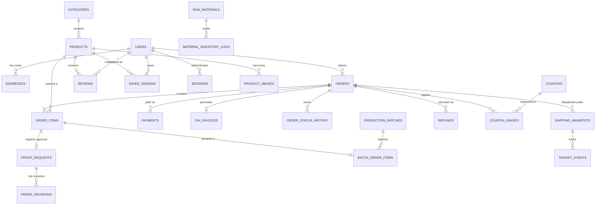

# Artआलय — Relational Database Architecture Specification
## Production-Grade PostgreSQL Schema Design & Traceability Mapping

**Document Version:** 1.0.0 (Master Architecture Release)  
**Author:** Winston (BMad System Architect 🏗️)  
**Collaborators:**  
- **Sofia (BMad Product Owner 🎯)** — Entity Lifecycle & Business Invariants  
- **Mary (BMad Business Analyst 📊)** — Indian Statutory GST & Audit Compliance  
- **Amelia (BMad Senior Software Engineer 💻)** — Query Optimization & Migration Strategy  

**Target RDBMS:** PostgreSQL 15+ (Standard SQL DDL)  
**Encoding:** UTF-8 (Supporting Devanagari Unicode `\u0900-\u097F` & Latin Typography)  
**Precision Standard:** Decimal Currency (`NUMERIC(10, 2)` for INR ₹, zero floating-point drift)  

---

## 1. Executive Architectural Summary

The Artआलय platform database architecture is engineered to balance **strict ACID compliance** for financial, inventory, and order fulfillment transactions with **extensible JSONB semi-structured documents** for 2D dynamic resin customizer states, GST tax breakdowns, and courier webhooks.

### Key Architectural Tenets:
1. **Zero License & Zero Lock-in:** 100% compliant with standard ANSI/ISO SQL and native PostgreSQL features. Runs seamlessly on local Docker containers, self-hosted Linux servers, or serverless DBs (Supabase, Neon, AWS RDS).
2. **Indian Statutory & Fiscal Invariants:**
   - Strict `NUMERIC(10, 2)` arithmetic for monetary amounts.
   - Dual-address structure separating **Billing Address** (for Place of Supply / GSTIN) from **Shipping Address** (for courier logistics).
   - HSN classification codes (`3926` for polymer resin articles, `4420` for inlaid woodcraft).
   - Deterministic sequential tax invoice numbering (`INV-YYYY-XXXXX`) immutable once generated.
3. **Resin Physical Process State Machine:** The order and proof schemas strictly model the physical slow resin curing timeline, preventing premature dispatch before finishing QC. Exact delivery dates are confirmed dynamically with the customer over WhatsApp.
4. **Zero-Drop Guest Checkout with Seamless Back-Linking:** Guest orders capture normalized customer contact points (`customer_phone`, `customer_email`) and are automatically claimed when a user creates an account with a matching verified phone number.

---

## 2. Entity-Relationship Diagram (ERD)



---

## 3. Database Table Dictionary & Specification

The schema comprises **24 relational tables** divided into 7 functional domains:

### 3.1 Domain 1: Identity, RBAC & Customer Management (`EPIC 0`)

| Table Name | Description | Key Invariants |
| :--- | :--- | :--- |
| `users` | Primary identity table for customers, artisans, workshop makers, and admins. | `phone` and `email` are unique (sparse); role defaults to `CUSTOMER`. Supports soft-deactivation. |
| `roles` | System authorization roles (`CUSTOMER`, `ARTISAN_ADMIN`, `WORKSHOP_MAKER`, `SUPER_ADMIN`). | Enum-backed RBAC with bitmask permission flags. |
| `addresses` | Customer address book supporting multiple addresses per user. | Distinct `tag` (Home, Work, Recipient); 6-digit Indian PIN code check `^[1-9][0-9]{5}$`. |
| `verification_tokens` | OTP tokens for phone SMS/WhatsApp authentication and email verification. | Strict TTL expiration (`expires_at < NOW() + INTERVAL '10 minutes'`), max 3 retry attempts. |
| `password_reset_tokens` | Single-use cryptographic reset tokens. | One-time consumption flag `is_used`, auto-invalidated after 1 hour. |
| `sessions` | Persistent customer web sessions. | Encrypted token, device fingerprint, IP logging. |

### 3.2 Domain 2: Catalog Merchandising & Product Specifications (`EPIC 2`, `EPIC 7`)

| Table Name | Description | Key Invariants |
| :--- | :--- | :--- |
| `categories` | Product hierarchy (Nameplates, Keyrings, Bookmarks, Festive Decor). | Unique URL `slug`, sorting priority. |
| `products` | Core product catalog records. | `base_price >= 0`, `product_type` (`READY_TO_SHIP` or `CUSTOMIZABLE`), `badge` enum, `customizer_config` JSONB. |
| `product_images` | High-res gallery media, multi-angle shots, and zoom layers. | Cloudinary / CDN asset URLs, display order, primary cover flag. |
| `reviews` | Customer ratings and social proof testimonials. | `rating BETWEEN 1 AND 5`, moderation status (`PENDING`, `APPROVED`, `REJECTED`), verified purchaser flag. |
| `raw_materials` | Workshop raw inventory tracking (Resin, Hardener, Timber Wood, Acrylic). | Low-stock threshold alerts, standard consumption units (kg, liters, sqft, count). |
| `material_inventory_logs` | Immutable audit log of raw material depletion and restocks. | Batch receipt, order depletion deduction, timestamp. |

### 3.3 Domain 3: 2D Customizer Engine & User Designs (`EPIC 1`)

| Table Name | Description | Key Invariants |
| :--- | :--- | :--- |
| `saved_designs` | User-saved customizer configurations and shareable deep links. | Unique 12-char nanoid `share_token`, complete canvas state in `design_state` JSONB, 300 DPI preview thumbnail URL. |

### 3.4 Domain 4: Checkout, Orders & Indian Tax Compliance (`EPIC 3`)

| Table Name | Description | Key Invariants |
| :--- | :--- | :--- |
| `orders` | Master order header for both guest and authenticated customers. | Unique human-readable `order_number` (e.g. `ART-2026-1049`), subtotal, discounts, shipping, tax, grand total. Separate `shipping_address` & `billing_address` JSONB snapshots. |
| `order_items` | Individual line items within an order. | References `products`, captures snapshot `unit_price`, HSN code (`3926` / `4420`), complete customized configuration in `customization_details` JSONB, and initial preview snapshot URL. |
| `tax_invoices` | Official Indian GST tax invoices. | Deterministic sequence `INV-2026-00001`, seller GSTIN, consumer B2C invoicing, State code, CGST, SGST, IGST breakdown, signed PDF storage URL. |
| `coupons` | Promotional vouchers and discount codes. | `code` uppercase unique, discount type (`PERCENTAGE` / `FLAT_AMOUNT`), minimum cart threshold, usage limits. |
| `coupon_usages` | Ledger tracking coupon redemptions per customer/order. | Prevents duplicate reuse of single-use welcome coupons. |
| `order_status_history` | Immutable timeline tracking every order state transition. | Previous status, new status, transition actor (System, Customer, Artisan), timestamp, optional note. |
| `refunds` | Financial refund records for pre-pour cancellations or defect compensations. | Razorpay refund ID, amount, reason, processed timestamp. |

### 3.5 Domain 5: Payments & Anti-RTO Governance (`EPIC 3`)

| Table Name | Description | Key Invariants |
| :--- | :--- | :--- |
| `payments` | Financial payment transactions. | Payment gateway reference (`razorpay_order_id`, `razorpay_payment_id`), signature verification status, gateway fee, net amount. |

### 3.6 Domain 6: Flexible Artisan Proof Approval Loop (`EPIC 4`)

| Table Name | Description | Key Invariants |
| :--- | :--- | :--- |
| `proof_requests` | Proof lifecycle header per custom order item. | Status (`PENDING_UPLOAD`, `PENDING_CUSTOMER_APPROVAL`, `APPROVED`, `SKIPPED_BY_ARTISAN`). Tracks proof image URL and artisan skip reason. |
| `proof_revisions` | Customer-requested adjustments before pouring. | Revision number (max 2), customer feedback text, adjusted mockup image URL, review timestamp. |

### 3.7 Domain 7: Workshop Kanban, Curing & Logistics (`EPIC 5`, `EPIC 6`)

| Table Name | Description | Key Invariants |
| :--- | :--- | :--- |
| `production_batches` | Workshop batch pours grouping multiple items of matching resin colorway. | Target colorway, total calculated resin volume (ml), hardener ratio, pour start timestamp, curing completion timestamp. |
| `batch_order_items` | Many-to-many junction linking order items to a production pour batch. | Batch assignment timestamp. |
| `shipping_manifests` | Courier package records generated via Shiprocket. | Shiprocket shipment ID, AWB number, courier partner (Bluedart, Delhivery), label PDF URL, packaging tier. |
| `transit_events` | Courier webhook tracking updates. | Location, transit status code, courier timestamp. |
| `transit_breakage_claims` | Safe transit guarantee replacement claims. | Customer unboxing photo/video URL, review outcome (`APPROVED_REPLACEMENT` / `REJECTED`), replacement order reference. |

---

## 4. Key JSONB Document Schemata

### 4.1 Polymorphic Customizer Configuration (`order_items.customization_details`)
Captures all user-selected parameters across the 4 streamlined artisanal categories with zero fake canvas defaults, direct WhatsApp reference photo attachment, and category-discriminated JSONB:

#### A. Nameplate Customizer (`NAMEPLATE`)
```json
{
  "type": "NAMEPLATE",
  "size": "16x10",
  "colorway": "OCEAN_WAVE",
  "typography": {
    "line1": "The Adhikaris",
    "line2": "Villa 42, Palm Greens",
    "fontFamily": "Cinzel",
    "material": "GOLD_MIRROR"
  },
  "hasLedBacklight": true,
  "referenceImage": "data:image/jpeg;base64,...",
  "substrate": "NATURAL_WOOD",
  "canvasSnapshotUrl": "https://cdn.artaalay.com/snapshots/ord_1049_render.png"
}
```

#### B. Crystal Monogram Keyring (`KEYRING`)
```json
{
  "type": "KEYRING",
  "letter": "A",
  "style": "GOLD_FOIL_CLEAR",
  "hardwareFinish": "BRUSHED_BRASS_GOLD",
  "charm": "MINI_TASSEL",
  "hasEngravedTag": true,
  "engravedText": "Aarav",
  "referenceImage": "data:image/jpeg;base64,...",
  "canvasSnapshotUrl": "https://cdn.artaalay.com/snapshots/ord_1050_render.png"
}
```

#### C. Pressed Botanical Bookmark (`BOOKMARK`)
```json
{
  "type": "BOOKMARK",
  "isPersonalized": true,
  "personalizedName": "Ananya",
  "hasFlowers": true,
  "colorChoice": "CRYSTAL_CLEAR",
  "referenceImage": "data:image/jpeg;base64,...",
  "canvasSnapshotUrl": "https://cdn.artaalay.com/snapshots/ord_1051_render.png"
}
```

#### D. Sacred Toran & Shubh Labh Entrance Decor (`FESTIVE`)
```json
{
  "type": "FESTIVE",
  "geodeColorway": "EMERALD_JADE",
  "scriptStyle": "SHUBH_LABH",
  "customText": "शुभ लाभ",
  "crystalBorder": "RAW_CLEAR_QUARTZ",
  "hangingElement": "BRASS_BELLS",
  "hasLedBacklight": true,
  "referenceImage": "data:image/jpeg;base64,...",
  "canvasSnapshotUrl": "https://cdn.artaalay.com/snapshots/ord_1052_render.png"
}
```

### 4.2 Indian GST Breakdown (`orders.tax_details` & `tax_invoices.tax_breakdown`)

```json
{
  "sellerStateCode": "27",
  "placeOfSupplyStateCode": "27",
  "isInterState": false,
  "hsnSummary": [
    {
      "hsnCode": "3926",
      "description": "Customized Polymer Resin Nameplate",
      "taxableAmount": 2117.80,
      "cgstRate": 9.0,
      "cgstAmount": 190.60,
      "sgstRate": 9.0,
      "sgstAmount": 190.60,
      "igstRate": 0.0,
      "igstAmount": 0.0,
      "totalTax": 381.20
    }
  ],
  "totalCgst": 190.60,
  "totalSgst": 190.60,
  "totalIgst": 0.0,
  "grandTaxTotal": 381.20
}
```

---

## 5. Traceability Matrix: User Stories to Database Entities

| Epic & User Story | Summary | Primary Tables & Columns | Integrity & Indexing Strategy |
| :--- | :--- | :--- | :--- |
| `US-0.1` | Registration & Login | `users (phone, email, password_hash)`, `verification_tokens` | Unique sparse index on phone & email; bcrypt cost 12. |
| `US-0.2` | RBAC Access Control | `users (role)`, `roles (name, permissions)` | Foreign key check against `user_role` enum. |
| `US-0.3` | Multi-Address Book | `addresses (user_id, full_name, street, pincode, state, is_default)` | Index on `(user_id, is_default)`; PIN code regex constraint. |
| `US-0.4` | Password Reset | `password_reset_tokens (token, user_id, expires_at, is_used)` | Unique index on token; automatic expiry index. |
| `US-0.5` | Guest Order Linking | `orders (customer_phone, user_id)`, `users (phone)` | Trigger auto-populates `user_id` when phone matches verified user. |
| `US-1.1` to `US-1.6` | 2D Customizer Studio | `order_items (customization_details, preview_image_url)`, `products (customizer_config)` | GIN index on `customization_details` JSONB. |
| `US-1.7` | Saved Custom Designs | `saved_designs (share_token, user_id, product_id, design_state, preview_url)` | Unique index on `share_token`; foreign keys to product and user. |
| `US-2.1` to `US-2.3` | Catalog & Media | `products (slug, title, base_price, badge, is_active)`, `product_images (url, is_primary)` | Unique index on `slug`; index on `(category_id, is_active)`. |
| `US-2.4` | Verified Buyer Reviews | `reviews (product_id, user_id, rating, comment, photo_urls, is_verified, status)` | Check `rating BETWEEN 1 AND 5`; index on `(product_id, status)`. |
| `US-2.5` | Catalog Search | `products (title, subtitle, description, tags)` | PostgreSQL `to_tsvector('english', ...)` full-text search GIN index. |
| `US-3.1` to `US-3.2` | Cart & Gifting Suite | `orders (is_gift, gift_message, gift_wrap_fee)`, `order_items` | Nullable gift message with character limit check `<= 300`. |
| `US-3.3` | Razorpay Payments | `payments (order_id, razorpay_order_id, razorpay_payment_id, status, amount)` | Unique constraint on `razorpay_order_id` & `razorpay_payment_id`. |
| `US-3.4` | Anti-RTO COD Deposit | `orders (is_cod_deposit, cod_deposit_amount, balance_cod_amount)` | Check `cod_deposit_amount + balance_cod_amount = grand_total`. |
| `US-3.6` | Guest Checkout | `orders (customer_phone, customer_email, shipping_address)` | Nullable `user_id` with NOT NULL `customer_phone`. |
| `US-3.7` | Separate Bill/Ship Addr | `orders (shipping_address, billing_address, is_billing_same_as_shipping)` | JSONB validation schema with phone, name, and address lines. |
| `US-3.8` | GST Tax Invoices | `tax_invoices (invoice_number, order_id, seller_gstin, total_tax, pdf_url)` | Unique sequential `invoice_number`; composite index on GSTIN. |
| `US-3.9` | Coupons & Promotions | `coupons (code, discount_type, discount_value, min_order_value)`, `coupon_usages` | Unique uppercase index on `code`; check `discount_value > 0`. |
| `US-3.10` | Cancellations & Refunds | `orders (status, cancellation_reason)`, `refunds (order_id, refund_amount, status)` | Cancellation allowed only if status in (`ORDER_CONFIRMED`, `PROOF_PENDING`). |
| `US-4.1` to `US-4.4` | Proof Approval Loop | `proof_requests (order_item_id, status, proof_image_url, is_skipped)`, `proof_revisions` | Foreign key to `order_items`; revision counter capped at 2. |
| `US-5.1` to `US-5.3` | Curing & Shiprocket | `orders (status)`, `shipping_manifests (shiprocket_awb, courier_name, tracking_url)` | Enum status transitions enforced via trigger; index on AWB. |
| `US-5.4` | Transit Breakage Claims| `transit_breakage_claims (order_id, photo_proof_urls, status, replacement_order_id)`| Foreign key to `orders`; replacement order reference. |
| `US-6.1` to `US-6.3` | Kanban & Batch Pours | `production_batches (colorway, resin_volume_ml, status)`, `batch_order_items` | Check `resin_volume_ml > 0`; index on batch status. |
| `US-7.1` to `US-7.3` | Artisan Merchandising | `products (badge, compare_at_price, inventory_count, customizer_config)` | Enum check on `badge`; check `compare_at_price >= base_price`. |
| `US-7.4` | Raw Material Inventory | `raw_materials (name, current_stock, minimum_threshold, unit)` | Check `current_stock >= 0`; alert trigger when below minimum. |
| `US-7.6` | Analytics Aggregations | Materialized Views & Indexes on `orders (created_at, grand_total, status)` | Grouped aggregations by day, week, and product category. |

---

## 6. Migration & Deployment Strategy

1. **Deterministic Execution:** The accompanying script [`database/schema.sql`](file:///d:/Projects/resin_website/database/schema.sql) can be executed using any PostgreSQL client:
   ```bash
   psql -U postgres -d art_aalay -f database/schema.sql
   ```
2. **Schema Verification Gate:**
   - All tables include `created_at` and `updated_at` timestamps managed by automatic trigger functions.
   - All monetary columns enforce positive values via check constraints.
   - Foreign key cascading is calibrated: user deletions do not cascade into financial orders or audit tables (they set `user_id = NULL` to preserve fiscal reporting integrity).

