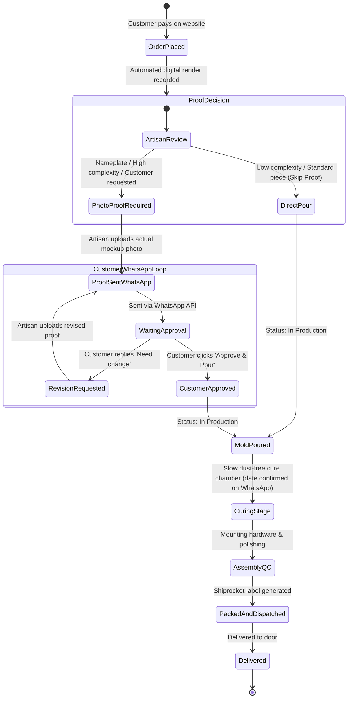
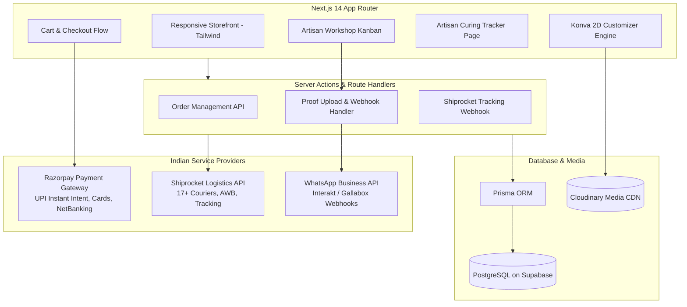

# Artआलय — Product Requirements & Technical Specification (MVP)

**Official Brand Name:** **Artआलय** (English *Art* + Devanagari *आलय*)  
**English Phonetic / URL Slug:** `artaalay` / `art-aalay`  
**Platform:** Next.js (React 18/19), TypeScript, Tailwind CSS, Konva.js (react-konva), Supabase (PostgreSQL), Prisma  
**Market:** Indian Domestic D2C (INR ₹, Razorpay UPI, Shiprocket, WhatsApp Business)  
**Status:** Approved for MVP Scaffolding  

---

## 1. Brand Identity & Creative Positioning

### 1.1 The Exact Brand Name: Artआलय
- **Styling:** **Artआलय** — A bold, intentional fusion of the English word **"Art"** with the Devanagari script **"आलय"** (*Aalay* = Abode / Sanctuary / Home).
- **Visual Presentation:** 
  - The wordmark displays **"Art"** in a refined, elegant serif or geometric display font, transitioning seamlessly into **"आलय"** in traditional Devanagari calligraphy with the characteristic *shirorekha* (top horizontal line).
  - Web Title / Metadata: `Artआलय — Handcrafted Resin Art for Heart & Home`
  - URL / Domain format: `artaalay.com` or `artaalay.in`
- **Brand Essence:** *"The Abode where Contemporary Art Meets Indian Soul"*. Modern epoxy resin craftsmanship housed inside an auspicious, warm home sanctuary.

### 1.2 Brand Aesthetics & Color Palette
- **Primary Color:** **Deep Resin Emerald** (`#0F3831`) — Rich, aquatic resin depth.
- **Secondary Color:** **Ocean Teal** (`#1A535C`) — Swirling epoxy wave patterns.
- **Metallic Accent:** **Molten Gold** (`#D4AF37`) — Mirror acrylic lettering and gold leaf flecks.
- **Organic Backdrop:** **Terracotta Sand** (`#F7F3EE`) & **Warm Ivory** (`#FFFDF9`).
- **Typography Palette:**
  - Latin Alphabet (*"Art"*): *Playfair Display* / *Cinzel* / *Plus Jakarta Sans*
  - Devanagari Script (*"आलय"*): *Rozha One* / *Yatra One* / *Noto Serif Devanagari* / *Tiro Devanagari Hindi*
- **Tagline Candidates:**
  1. *Artआलय — Where Craft Meets Home*
  2. *Artआलय — आपका कला आलय*
  3. *Artआलय — जहाँ हर रचना एक एहसास है*

---

## 2. MVP Product Scope (The Core 4)

```
                            ┌─────────────────────────────────┐
                            │    KALAALAY MVP HERO FOUR       │
                            └────────────────┬────────────────┘
              ┌──────────────────┬───────────┴───────────┬──────────────────┐
              ▼                  ▼                       ▼                  ▼
      [1. Name Plates]    [2. Keyrings]           [3. Bookmarks]     [4. Shubh Labh]
      • Solid Wood + Resin• Letter Monograms      • Clear Botanicals • Swastik & Ganesh
      • Gold Acrylic 3D   • Photo Embeds          • Gold Flakes      • Pearl Embellishments
      • Optional Warm LED • Tassel Accents        • Calligraphy Name • 3M Door Adhesive
      • ₹1,899 – ₹4,499   • ₹249 – ₹499           • ₹299 – ₹549      • ₹599 – ₹1,299
```

### Detailed MVP Product Specifications

#### Product 1: Bespoke House & Office Name Plates
- **Target Customer:** New homeowners, wedding gifts, Griha Pravesh ceremonies, doctor/lawyer office doors.
- **Physical Construction:** 
  - Substrate: Handcrafted seasoned solid natural wood base (artisan-selected natural hardwood; customer cannot choose wood species).
  - Resin Layer: Single or double ocean wave froth / deep emerald geode swirl with real crystal inlays.
  - Typography: Laser-cut 3mm raised mirror acrylic letters (Mirror Gold, Rose Gold, Gloss Black, Silver).
  - Optional Hardware: Integrated 12V waterproof warm LED backlighting with power adapter; concealed wall mounting keyholes.
- **Customizer Inputs (Streamlined 5-Point Core):**
  - Line 1 (Family / Business Name, e.g. *"Nirvana"*, *"The Kapoors"*, max 20 chars).
  - Line 2 (Subtext / House No., e.g. *"Villa 42, Palm Greens"*, max 28 chars).
  - Colourway: Ocean Wave, Emerald Geode, Ruby Wine, Midnight Gold.
  - Size Options: Standard (12" x 8"), Grand (16" x 10", +₹500), Executive (18" x 12", +₹900).
  - LED Inclusion: 12V Warm LED Backlighting (+₹799).
  - Reference Photo Upload: Upload sample/entrance picture for direct WhatsApp consultation with lead artisan before pouring.

#### Product 2: Initial Monogram & Keepsake Keyrings
- **Target Customer:** Everyday impulse purchase, college students, birthday hampers, return gifts.
- **Physical Construction:** 
  - Dimensions: Height 4.5 cm, Thickness 0.8 cm.
  - Metal: Heavy-duty metal ring and connector chain (Brushed Brass Gold, Rose Gold Luxe, Matte Silver).
  - Embeds: Optical crystal resin with suspended gold leaf flecks or botanical petals.
  - Accents: Optional dangling mini charm (Mini Tassel, Evil Eye Bead, Pearl Heart).
- **Customizer Inputs (Streamlined):**
  - Monogram Initial (A-Z quick selector) & optional engraved text tag (max 10 chars).
  - Resin Style / Colour: 24K Gold Flake Clear, Blush Rose Petal, Emerald Mint, Midnight Obsidian.
  - Hardware Metal Finish: Brushed Brass Gold, Rose Gold Luxe, Matte Silver.
  - Optional Dangling Charm: None, Mini Tassel (+₹49), Evil Eye Bead (+₹79), Pearl Heart (+₹79).
  - Reference Photo Upload: Sample reference upload with direct artisan WhatsApp consultation.

#### Product 3: Pressed Floral & Botanical Bookmarks
- **Target Customer:** Book lovers, students, journaling enthusiasts, mindful gifting.
- **Physical Construction:** 
  - Dimensions: 14 cm x 2.8 cm (5.5" x 1.2"), Thickness 2.5 mm (ultra-slim profile to protect book spines).
  - Resin Finish: High-clarity UV-resistant crystal resin with hand-beveled edges.
  - Embellishment: Real dried wildflower blooms, brass eyelet loop, silk cord tassel.
- **Customizer Inputs (3 Core Decisions + WhatsApp Reference):**
  - Personalization: Recipient name (optional, max 24 chars, +₹49).
  - Flower Inclusion: Real pressed wildflower blooms (Yes / Plain optical resin).
  - Colour Palette: Crystal Clear, Ocean Teal, Blush Rose, Emerald Forest, Golden Amber, Royal Amethyst.
  - Reference Photo Upload: Sample reference upload with direct artisan WhatsApp consultation.

#### Product 4: Auspicious Resin Shubh Labh Sets
- **Target Customer:** Diwali festive decor, Griha Pravesh, Pooja room entrance, mandir doors.
- **Physical Construction:** 
  - Form: Pair of circular geode discs (4" diameter each) with crystalline rim and 24K gold foil veins.
  - Base: High-gloss resin with vibrant auspicious minerals (Emerald Jade, Royal Crimson Sindoor, Auspicious Haldi Gold, Midnight Obsidian).
  - Centerpieces: Raised 3D metallic mirror gold Devanagari calligraphy ("शुभ लाभ", "सुस्वागतम्", "ॐ व 卐", or custom blessing).
  - Accents: Pure brass temple bells (+₹199) or royal marigold tassels; optional 12V warm LED halo glow (+₹399).
- **Customizer Inputs (Streamlined):**
  - Auspicious Calligraphy: Shubh Labh, Suswagatam, Om Swastik, or Custom Blessing (up to 24 chars).
  - Geode Colourway: Emerald Jade, Royal Crimson Sindoor, Auspicious Haldi Gold, Midnight Obsidian.
  - Traditional Hanging Finish: Pure Brass Temple Bells (+₹199) or Royal Marigold Tassels.
  - 12V LED Halo Backlight: Warm golden aura glow (+₹399).
  - Reference Photo Upload: Mandir/door reference photo with direct artisan WhatsApp consultation.

---

## 3. The 2D Interactive Customizer Engine

### 3.1 Technology Choice: Konva.js (`react-konva`)
- **Rendering Speed:** Hardware-accelerated 2D canvas running at 60fps on mobile browsers.
- **Layering Model:** Uses standard React component hierarchy (`<Stage> -> <Layer> -> <Group> -> <Image | Text | Rect>`).
- **Texture Blending:** Photographic high-res PNG swatches combined with canvas blend modes for realistic light reflection and translucent resin depth.
- **High-Resolution Export:** 
  ```javascript
  const highResProofData = stageRef.current.toDataURL({
    pixelRatio: 3, // Exports 3x resolution (300 DPI equivalent for print/proof)
    mimeType: 'image/jpeg',
    quality: 0.95
  });
  ```

### 3.2 Dynamic Pricing Matrix
The price updates synchronously as options change:
$$\text{Total Price} = \text{Base Product Price} + \text{Size Surcharge} + \sum \text{Selected Inclusions} + \text{Hardware/LED Add-ons}$$

---

## 4. Production Workflow & The Hybrid Proof Approval Loop



### 4.1 How the Flexible Proof Approval Works
1. **At Checkout:** The customer's customizer state generates an instant digital mockup stored with the order.
2. **On Artisan Dashboard:**
   - Every order shows two big action buttons:
     - `[Send Photo Proof to WhatsApp]` (Opens file uploader for photo of raw layout/mockup).
     - `[Skip Proof & Proceed to Pour]` (Instantly advances order to "In Production").
3. **If Proof is Sent:**
   - Customer receives a WhatsApp message with the photo:
     > *"Namaste [Customer Name]! 🌸 Here is the handcrafted mockup of your custom Name Plate for Order #KA-1082. Please review the spelling and layout."*
     > `[✅ Approve & Start Pouring]` | `[✏️ Request Change]`
   - Customer click updates the database order status instantly via webhook.

---

## 5. Indian E-Commerce Infrastructure Architecture



---

## 6. Project Database Schema (Prisma Model Definition)

```prisma
datasource db {
  provider = "postgresql"
  url      = env("DATABASE_URL")
}

generator client {
  provider = "prisma-client-js"
}

enum Role {
  CUSTOMER
  ARTISAN_ADMIN
  WORKSHOP_MAKER
  SUPER_ADMIN
}

enum ProductType {
  READY_TO_SHIP
  CUSTOMIZABLE
}

enum ProductBadge {
  BESTSELLER
  MASTERPIECE
  FESTIVE_SPECIAL
  LIMITED_EDITION
  NEW_ARRIVAL
}

enum OrderStatus {
  PAYMENT_PENDING
  ORDER_CONFIRMED
  PROOF_PENDING
  PROOF_APPROVED
  IN_PRODUCTION      // In mold & slow chemical curing (lead time confirmed on WhatsApp)
  FINISHING_QC       // Polishing & hardware assembly
  PACKED
  DISPATCHED
  DELIVERED
  CANCELLED
}

enum PaymentStatus {
  PENDING
  SUCCESS
  FAILED
  REFUNDED
}

model User {
  id              String        @id @default(uuid())
  phone           String?       @unique
  email           String?       @unique
  name            String?
  passwordHash    String?
  avatarUrl       String?
  role            Role          @default(CUSTOMER)
  isPhoneVerified Boolean       @default(false)
  isEmailVerified Boolean       @default(false)
  addresses       Address[]
  orders          Order[]
  createdAt       DateTime      @default(now())
  updatedAt       DateTime      @updatedAt
}

model Address {
  id          String   @id @default(uuid())
  userId      String
  user        User     @relation(fields: [userId], references: [id], onDelete: Cascade)
  tag         String   @default("Home") // Home, Office, Other
  fullName    String
  phone       String
  street      String
  landmark    String?
  city        String
  state       String
  pincode     String
  isDefault   Boolean  @default(false)
  createdAt   DateTime @default(now())
}

model Product {
  id                 String          @id @default(uuid())
  slug               String          @unique // e.g. bespoke-teakwood-nameplate
  title              String
  subtitle           String?
  description        String?
  category           String          // name-plate, keyring, bookmark, shubh-labh
  productType        ProductType     @default(CUSTOMIZABLE)
  badge              ProductBadge?   // BESTSELLER, MASTERPIECE, etc.
  basePrice          Float
  compareAtPrice     Float?          // Strike-through MRP
  inventoryCount     Int             @default(50)
  lowStockThreshold  Int             @default(5)
  images             String[]
  videoUrl           String?
  isActive           Boolean         @default(true)
  customizerConfig   Json?           // Allowed fonts, swatches, inclusions, character limits
  createdAt          DateTime        @default(now())
  updatedAt          DateTime        @updatedAt
  orderItems         OrderItem[]
}

model Order {
  id                   String        @id @default(uuid())
  orderNumber          String        @unique // e.g. AA-2026-1001
  userId               String?       // Nullable for guest checkout
  user                 User?         @relation(fields: [userId], references: [id])
  customerPhone        String        // Fast lookup for guest orders
  customerEmail        String?
  status               OrderStatus   @default(ORDER_CONFIRMED)
  paymentStatus        PaymentStatus @default(PENDING)
  razorpayOrderId      String?
  razorpayPaymentId    String?
  subtotal             Float
  discount             Float         @default(0)
  couponCode           String?
  shippingFee          Float         @default(0)
  taxAmount            Float         @default(0) // CGST + SGST or IGST
  taxDetails           Json?         // { hsn: "3926", cgstRate: 9, sgstRate: 9, igstRate: 0, placeOfSupply: "KA" }
  grandTotal           Float
  shippingAddress      Json          // Full delivery address
  billingAddress       Json?         // Distinct billing address (if different from shipping)
  b2bDetails           Json?         // { companyName: "...", gstin: "..." } for B2B ITC claim
  isGift               Boolean       @default(false)
  giftMessage          String?
  invoiceNumber        String?       @unique // Consecutive FY format, e.g. AA/26-27/0042
  invoicePdfUrl        String?       // Immutable PDF storage URL
  isCodDeposit         Boolean       @default(false)
  codDepositAmount     Float?
  shiprocketShipmentId String?
  shiprocketAwb        String?
  trackingUrl          String?
  items                OrderItem[]
  createdAt            DateTime      @default(now())
  updatedAt            DateTime      @updatedAt
}

model OrderItem {
  id                   String        @id @default(uuid())
  orderId              String
  order                Order         @relation(fields: [orderId], references: [id], onDelete: Cascade)
  productId            String
  product              Product       @relation(fields: [productId], references: [id])
  quantity             Int           @default(1)
  unitPrice            Float
  hsnCode              String        @default("3926") // HSN 3926 (Resin) or 4420 (Wood Inlaid)
  customizationDetails Json?         // Selected text, font, colors, inclusions, dimensions
  previewImageUrl      String?       // 300 DPI Render generated by canvas
  proofImageUrl        String?       // Actual physical photo uploaded by artisan
  proofStatus          String        @default("NOT_REQUIRED") // NOT_REQUIRED, PENDING_APPROVAL, APPROVED, REVISED
  proofRevisionCount   Int           @default(0)
}

model Coupon {
  id                String    @id @default(uuid())
  code              String    @unique // e.g. DIWALI200
  discountType      String    // PERCENTAGE or FLAT
  discountValue     Float
  maxDiscountAmount Float?    // Cap for percentage discounts
  minOrderValue     Float     @default(0)
  usageLimit        Int?
  usageCount        Int       @default(0)
  isActive          Boolean   @default(true)
  expiresAt         DateTime?
  createdAt         DateTime  @default(now())
}

model Review {
  id         String   @id @default(uuid())
  productId  String
  product    Product  @relation(fields: [productId], references: [id])
  userId     String?
  user       User?    @relation(fields: [userId], references: [id])
  authorName String
  rating     Int      // 1 to 5 stars
  headline   String?
  comment    String
  photoUrls  String[] // Real customer photos
  isVerified Boolean  @default(false) // Verified Buyer flag
  status     String   @default("APPROVED") // APPROVED, PENDING, REJECTED
  createdAt  DateTime @default(now())
}

model PasswordResetToken {
  id         String   @id @default(uuid())
  identifier String   // email or phone
  token      String   @unique
  expiresAt  DateTime
  createdAt  DateTime @default(now())
}

model VerificationToken {
  id         String   @id @default(uuid())
  identifier String   // 10-digit mobile phone
  token      String   // 6-digit cryptographic OTP
  attempts   Int      @default(0)
  expiresAt  DateTime
  createdAt  DateTime @default(now())

  @@index([identifier])
  @@index([token])
}
```

---

## 7. Next Steps & Scaffolding Execution Plan

With these requirements locked in, the implementation sequence is:
1. **Initialize Next.js 14+ Project** with TypeScript, Tailwind CSS, and essential UI utilities.
2. **Build the Konva.js Customizer Engine** with interactive templates for the 4 MVP products:
   - Name Plate configurator (Wood/Acrylic base, Ocean/Geode resin, 3D gold letters, LED preview).
   - Keyring configurator (Initial letter, gold flakes, floral inclusions, tassel color).
   - Bookmark configurator (Pressed botanical blooms, foil flecks, custom calligraphy name).
   - Shubh Labh configurator (Medallion shape, sacred motifs, kundan/pearl borders).
3. **Storefront & Navigation** with artisan aesthetic (`#0F3831` Deep Emerald, `#D4AF37` Gold, `#F7F3EE` Sand).
4. **Checkout & Indian Gateway Setup** (Razorpay integration mock & live ready).
5. **Artisan Studio Kanban Dashboard** with proof photo upload and "Skip Proof" toggles.

