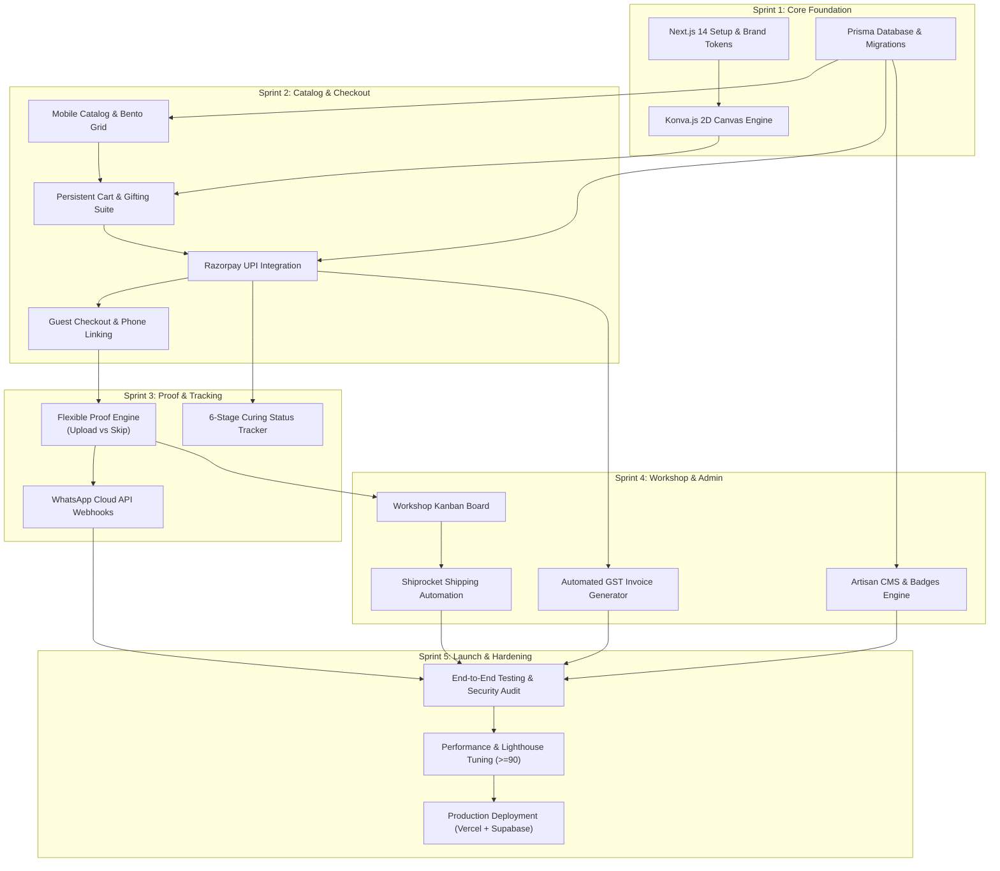
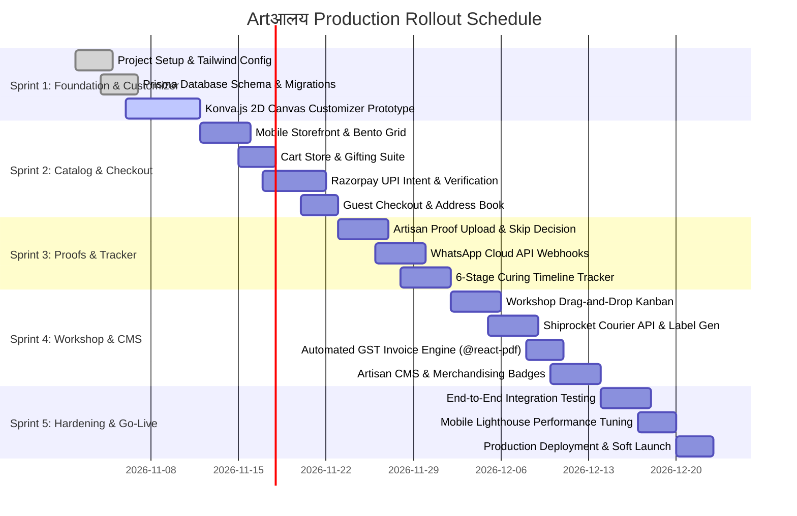

# Artआलय — Project Execution Plan & Delivery Blueprint
## Sprint Roadmap, Critical Path, Dependency Network & Resource Architecture

**Document Version:** 1.0.0  
**Lead Author:** John (BMad Product Manager / Project Lead 📋)  
**Collaborators:**  
- **Sofia (Product Owner 🎯)** — Backlog Governance & Sprint Acceptance  
- **Winston (System Architect 🏗️)** — Technical Critical Path & Infrastructure Dependencies  
- **Mary (Business Analyst 📊)** — Regulatory Milestones & Traceability Validation  
- **Sally (UX Designer 🎨)** — Design Tokens, Component Handoff & Interaction QA  

**Platform Name:** **Artआलय** (Handcrafted Resin E-Commerce Platform)  
**Target Delivery Window:** 6-Week Production Rollout (5 Sprints + Launch Hardening)  
**Execution Methodology:** Agile Scrum with Continuous Delivery & BMad Verification Gates  

---

## 1. Cross-Functional Alignment & Consistency Audit

```
┌─────────────────────────────────────────────────────────────────────────────┐
│                 BMAD 5-AGENT CROSS-FUNCTIONAL REVIEW                        │
├─────────────────────────────────────────────────────────────────────────────┤
│ 📋 John (PM):                                                               │
│ "Team, let's verify that UX, Architecture, and Business Logic are 100%      │
│ aligned before we sequence our engineering tasks and lock dependencies."   │
│                                                                             │
│ 🎨 Sally (UX):                                                              │
│ "The mobile customizer requires pre-cached WebP swatches (<35KB) to load    │
│ in <100ms on 4G. The Zustand store must be decoupled from network lag."    │
│                                                                             │
│ 🏗️ Winston (Architect):                                                     │
│ "Confirmed. Next.js Server Components handle catalog SEO while Konva.js    │
│ runs purely client-side. The database schema, Razorpay gateway, and Ship-   │
│ rocket clients can be developed in parallel with UI customizer components." │
│                                                                             │
│ 📊 Mary (BA):                                                               │
│ "The physical 24–48 hour curing timeline must be hard-coded as a state-     │
│ machine invariant: orders cannot jump to 'Dispatched' without curing QC."   │
│                                                                             │
│ 🎯 Sofia (PO):                                                              │
│ "Every sprint must produce a working, testable increment. Sprint 1 must     │
│ prove the 2D customizer engine. Sprint 2 proves checkout. Zero mock lag."   │
└─────────────────────────────────────────────────────────────────────────────┘
```

### Consistency Checks Verified
1. **Design System & Tailwind Config:** Sally's tokens (`#0F3831` Resin Emerald, `#D4AF37` Molten Gold, `#F7F3EE` Terracotta Sand) map 1:1 to Winston's `tailwind.config.ts`.
2. **Customizer & Data Schema:** The JSON output generated by `useCustomizerStore` matches the `OrderItem.customizationDetails` schema in `schema.prisma`.
3. **Role & Route Middleware:** Sally's `/admin` UI routes match Winston's `middleware.ts` RBAC role requirements (`ARTISAN_ADMIN`, `WORKSHOP_MAKER`).
4. **GST Tax Engine & Invoice Generation:** Mary's tax calculation rules (Intra-state CGST+SGST vs Inter-state IGST) are directly embedded into the asynchronous `@react-pdf/renderer` invoice worker.

---

## 2. Project Dependency Network & Critical Path Analysis

### 2.1 Technical Dependency Graph (DAG)



### 2.2 Critical Path Items (Zero-Slack Tasks)
The Critical Path determines the minimum duration of the project:
1. **Next.js Scaffold & Prisma Schema Setup (Days 1–3)**
2. **Konva.js 2D Customizer Engine & Layer Stacking (Days 4–10)**
3. **Razorpay Server-Side Order Creation & UPI Intent (Days 11–16)**
4. **Flexible Proof Approval & WhatsApp Webhook Engine (Days 17–22)**
5. **Shiprocket Courier Integration & Workshop Kanban (Days 23–28)**
6. **End-to-End Security, Tax Validation & Production Deployment (Days 29–35)**

*Delay on any of the above 6 milestones directly impacts the production launch date.*

---

## 3. Sprint Delivery Roadmap (5 Sprints / 6 Weeks)



---

### Detailed Sprint Slices & Deliverables

#### SPRINT 1: Core Foundation & 2D Customizer Engine (Days 1–10)
* **Goal:** Prove the riskiest UX interaction—a 60fps responsive 2D canvas customizer.
* **Epics Covered:** Part of `EPIC-0` (Base Models), `EPIC-1` (`US-1.1` to `US-1.7`).
* **Deliverables:**
  - Initialized Next.js 14 App Router project with TypeScript and Tailwind CSS.
  - Brand theme configured (`#0F3831`, `#D4AF37`, `#F7F3EE`, `#FFFDF9`).
  - Prisma schema deployed to PostgreSQL on Supabase.
  - Working **Bespoke Nameplate Customizer** (Teakwood/Acrylic base, Ocean/Geode swatches, 3D gold letters, character limiter, live price calculation).
  - 300-DPI high-res canvas snapshot generation (`stage.toDataURL({ pixelRatio: 3 })`).
* **Exit Criteria (Definition of Done):** Customizer runs smoothly at 60fps on mobile viewports; exports clean 2400x2400px image; pricing updates synchronously.

---

#### SPRINT 2: Mobile Storefront, Cart & Frictionless Checkout (Days 11–18)
* **Goal:** Enable end-to-end purchasing via mobile UPI with transparent order summaries.
* **Epics Covered:** `EPIC-2` (`US-2.1`, `US-2.2`, `US-2.3`, `US-2.5`), `EPIC-3` (`US-3.1` to `US-3.7`, `US-3.9`).
* **Deliverables:**
  - Mobile-first Storefront with Bento Grid layout and occasion filter chips.
  - Product Details Pages (PDPs) with "Artisan Craft Disclaimer" and Resin Care Drawer.
  - Predictive search bar (`/api/search/suggest`) with thumbnail auto-suggest.
  - Persistent shopping cart (`useCartStore`) with design restoration (`[Edit Design]`).
  - Gifting options card (handwritten message + concealed packing slip pricing).
  - Razorpay mobile UPI Intent integration (PhonePe, GPay, Paytm) with HMAC verification.
  - Frictionless Guest Checkout with automatic phone-number order linking.
* **Exit Criteria (DoD):** Successful test payment via Razorpay sandbox triggering order creation with correct CGST/SGST/IGST tax calculation; cart persists across mobile reloads.

---

#### SPRINT 3: Flexible Artisan Proof & The Curing Tracker (Days 19–26)
* **Goal:** Connect the physical artisan studio with the customer's phone.
* **Epics Covered:** `EPIC-4` (`US-4.1` to `US-4.4`), `EPIC-5` (`US-5.1` to `US-5.3`).
* **Deliverables:**
  - Artisan Proof Action Card (`[📸 Upload Photo Proof]` vs `[⚡ Skip Proof & Pour]`).
  - WhatsApp Cloud API integration dispatching high-res layout photos with interactive `[Approve & Pour]` and `[Request Change]` buttons.
  - Webhook handler updating database states upon customer WhatsApp button clicks.
  - Public 6-stage **Curing & Crafting Status Tracker** (`/track/[orderNumber]`) educating users on the 48-hour chemical resin curing rest.
* **Exit Criteria (DoD):** Uploading a photo proof in the admin dashboard sends a live WhatsApp message; tapping "Approve" moves the order to `PROOF_APPROVED` within 2 seconds.

---

#### SPRINT 4: Workshop Kanban, Logistics & Artisan CMS (Days 27–34)
* **Goal:** Equip workshop operators to manufacture, batch-pour, package, and dispatch without manual paperwork.
* **Epics Covered:** `EPIC-6` (`US-6.1` to `US-6.4`), `EPIC-7` (`US-7.1` to `US-7.6`), `EPIC-3` (`US-3.8`, `US-3.10`).
* **Deliverables:**
  - Drag-and-drop workshop Kanban board (`Proof Pending` ➔ `Ready to Pour` ➔ `In Curing` ➔ `Finishing` ➔ `QC & Pack` ➔ `Dispatched`).
  - Batch Pouring Calculator aggregating total resin volume (ml) and 2:1 Part A/Part B mixing ratios.
  - 1-click printable A4 physical job sheets with vector outlines for laser cutters.
  - Automated GST Tax Invoice generation (`@react-pdf/renderer`) with HSN 3926/4420.
  - Shiprocket API integration: 1-click AWB generation, 4"x6" thermal labels, and courier pickup scheduling.
  - Artisan CMS: Product CRUD, image gallery upload, marketing badges (`Masterpiece`, `Bestseller`), and sales analytics dashboard.
* **Exit Criteria (DoD):** 1-click thermal courier label printed; legal PDF tax invoice generated; batch pouring calculator sums volumes accurately.

---

#### SPRINT 5: Hardening, Security Audit & Production Launch (Days 35–42)
* **Goal:** Production-grade security, mobile performance tuning, and commercial go-live.
* **Epics Covered:** All NFRs (`NFR-01` to `NFR-07`), User Reviews (`US-2.4`).
* **Deliverables:**
  - Verified Customer Reviews & Photo Testimonials module with post-delivery WhatsApp trigger.
  - Security review: Edge RBAC middleware audit, webhook HMAC validation verification, secret rotation.
  - Mobile Lighthouse optimization (targeting >= 90 score on performance, accessibility, SEO).
  - Production environment configuration on Vercel (Frontend/API) and Supabase (PostgreSQL).
  - Soft launch with artisan workshop testing.
* **Exit Criteria (DoD):** 0 critical/high security vulnerabilities; mobile Lighthouse >= 90; end-to-end order-to-dispatch flow verified with live money and real courier pickup.

---

## 4. Skills & Resource Requirements

To deliver Artआलय within the 6-week timeframe, the following resource profiles and technical competencies are required:

| Role | Headcount | Key Technical Competencies | Primary Responsibilities |
| :--- | :--- | :--- | :--- |
| **Frontend Engineer (Lead)** | 1 | React 18/19, Next.js 14 App Router, TypeScript, **Konva.js (`react-konva`)**, HTML5 Canvas, Tailwind CSS, Framer Motion | Canvas customizer architecture, mobile thumb-zone layout, performance optimization, client Zustand stores. |
| **Fullstack / Backend Engineer** | 1 | Node.js, Next.js API Routes, **Prisma ORM**, PostgreSQL, **Razorpay SDK**, **Shiprocket REST API**, WhatsApp Cloud API, `@react-pdf/renderer` | Database migrations, webhook handlers, payment verification, courier integrations, automated PDF invoice pipeline. |
| **UI/UX & Asset Designer** | 1 (Part-Time) | Figma, Framer, Photo editing, 3D texture mapping, Micro-animations | Creating high-res seamless WebP resin swatches, wood grain textures, marketing badge icons, and design QA. |
| **QA / Automation Engineer** | 1 (Part-Time) | Playwright / Cypress, Jest, Postman, Mobile device testing (iOS & Android) | Canvas export visual regression tests, payment webhook mocking, cross-device mobile browser testing. |

---

## 5. Risk Management & Mitigation Matrix

| Risk Event | Severity | Likelihood | Impact on Delivery | Preventive Architectural Strategy |
| :--- | :--- | :--- | :--- | :--- |
| **Canvas lag on budget Android smartphones** | **High** | Medium | User abandons customizer due to choppy typing or dragging. | Offload all filters to static pre-rendered WebP textures; render text using standard Konva text shapes with hardware acceleration; limit stage canvas dimensions to 800x800 internal virtual pixels. |
| **Razorpay payment webhook dropped or delayed** | **High** | Low | Order marked unpaid despite customer money debited. | Implement dual confirmation: verify via synchronous client-side signature check upon redirect, backed by an idempotent, retryable server webhook endpoint. |
| **WhatsApp template message rejection by Meta** | **Medium** | Medium | Photo proof delivery delayed. | Pre-submit WhatsApp templates (Order Confirmation, Proof Review, Transit Update) during Sprint 1. Fallback to SMS + passwordless web link (`/proof/[token]`). |
| **Shiprocket courier API rate limits during festive spikes** | **Medium** | Low | Pincode check slows down checkout. | Cache pincode serviceability and estimated transit days in Redis / memory cache with a 7-day TTL. |
| **Return-to-Origin (RTO) on personalized COD orders** | **High** | Medium | Artisan loses money on customized unsellable goods. | Enforce mandatory non-refundable ₹199 advance commitment fee collected online via UPI before confirming COD orders. |

---

## 6. Project Manager Sign-Off (John 📋)

This Project Execution Plan translates the complete vision of **Artआलय** into an achievable, risk-managed engineering roadmap. 

Every dependency is mapped, the critical path is bounded, and the definition of done is strictly testable.

**Approved for Project Kickoff:** John (BMad Project Manager / Product Lead 📋)

