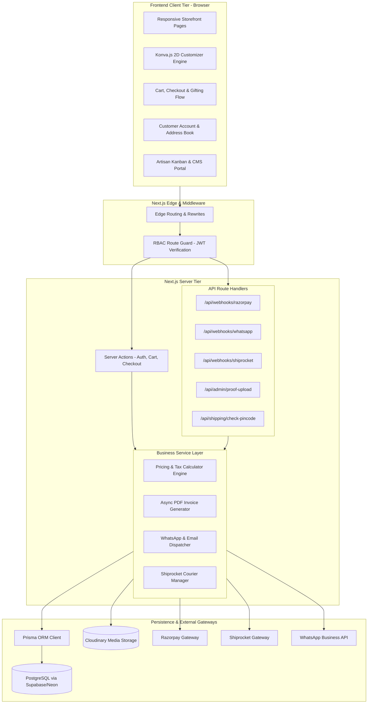
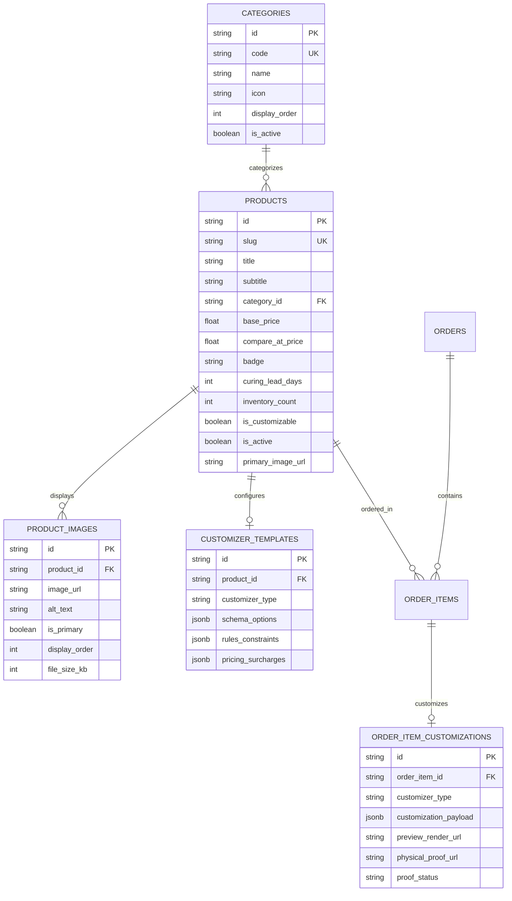
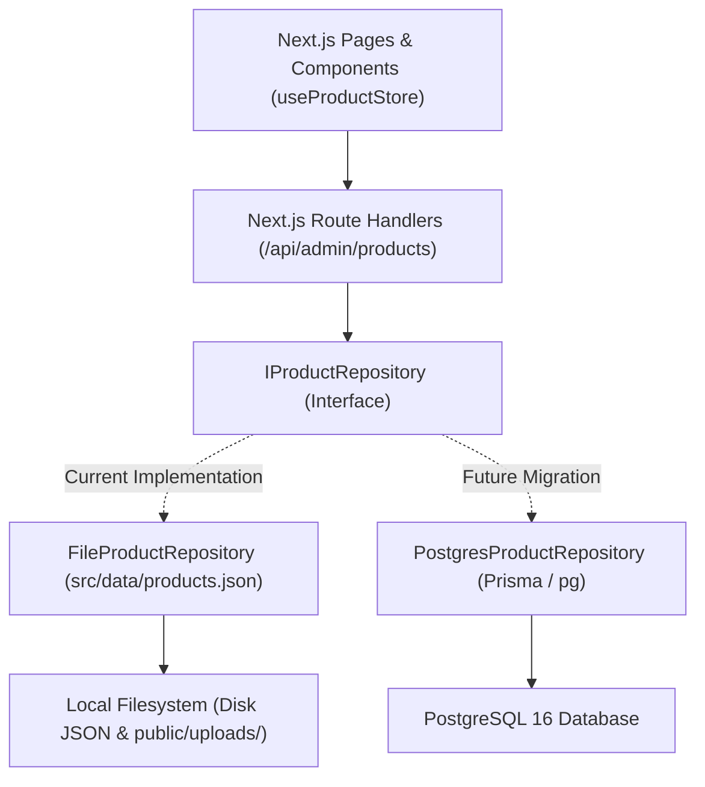
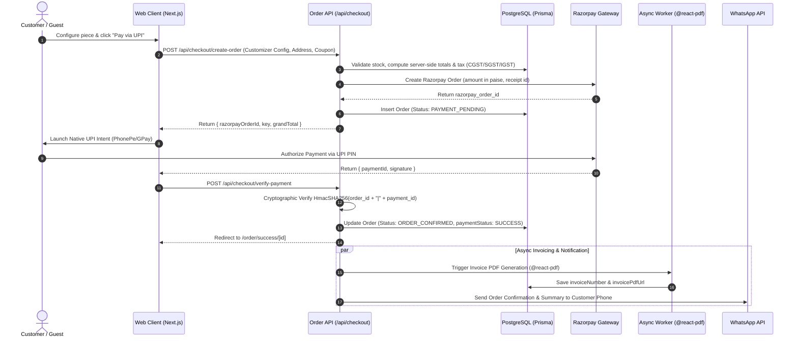
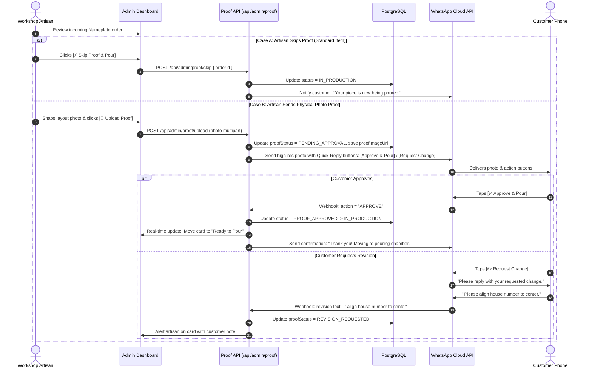
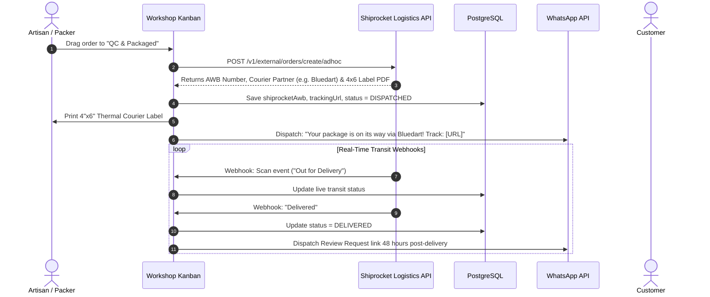

# Artआलय — Technical Architecture & System Design Document (TDD)

**Document Version:** 1.0.0  
**Author:** Winston (BMad System Architect Agent 🏗️)  
**Collaborators:** Sofia (Product Owner 🎯) & Mary (Business Analyst 📊)  
**Status:** Approved for Codebase Implementation  
**Target Repository:** `resin_website`  
**Target Domain:** D2C E-Commerce & Real-Time Customizer Engine for Handcrafted Resin Products  
**Market Envelope:** India Domestic D2C (INR ₹, UPI via Razorpay, Shiprocket Logistics, WhatsApp Cloud API)  

---

## 1. System Overview & Architectural Paradigm

### 1.1 The Architectural Paradigm: Hybrid Server-Driven D2C with Edge State
Artआलय is architected as a **Hybrid Server-Driven Application** utilizing the **Next.js 14+ App Router** (React Server Components + Client-Side Canvas Isolates).

```
┌─────────────────────────────────────────────────────────────────────────────┐
│                    Artआलय SYSTEM CONTEXT (C4 LEVEL 1)                       │
└─────────────────────────────────────────────────────────────────────────────┘

    [Shopper / Gifter]               [Artisan Workshop Maker]
            │                                    │
            ▼                                    ▼
    ┌─────────────────────────────────────────────────────────────────┐
    │                      Artआलय Web Platform                        │
    │  • Next.js 14 App Router (RSC + Edge Middleware)                │
    │  • Konva.js 2D Canvas Customizer (Hardware-Accelerated)         │
    │  • Workshop Kanban & Proof Management Dashboard                 │
    └───────────────┬────────────────────────────┬────────────────────┘
                    │                            │
       Internal APIs│               External APIs│
                    ▼                            ▼
    ┌───────────────────────────────┐  ┌──────────────────────────────┐
    │ Persistence & Storage Layer   │  │ Third-Party Service Gateways │
    │ • PostgreSQL (Supabase/Neon)  │  │ • Razorpay (UPI, Cards)      │
    │ • Prisma ORM                  │  │ • Shiprocket (17+ Couriers)  │
    │ • Cloudinary (Media & Proofs) │  │ • WhatsApp Cloud API         │
    └───────────────────────────────┘  └──────────────────────────────┘
```

### 1.2 Core Architectural Invariants (The Non-Negotiables)
1. **Server-Side Financial Truth:** Pricing, coupon evaluations, tax calculations, and order creation must execute strictly server-side. The client customizer submits an option payload, never a final price.
2. **Deterministic Canvas Serialization:** The customizer canvas state must serialize into a strict, versioned JSON schema and an immutable 300-DPI render snapshot before checkout authorization.
3. **Webhook Idempotency:** All inbound webhooks (Razorpay, Shiprocket, WhatsApp) must be idempotent, cryptographically verified (`HmacSHA256`), and process events in atomic database transactions.
4. **Decoupled Heavy Workloads:** Heavy operations (PDF tax invoice rendering, image watermark processing, WhatsApp campaign dispatches) execute asynchronously off the HTTP request path.

---

## 2. Architecture Decisions (ADs)

> [!NOTE]
> For the comprehensive comparative evaluation, pros/cons matrix, and zero-license / zero-operational-cost analysis, refer to [**`docs/TECHNICAL_SELECTION_AND_TRADE_OFF_ANALYSIS.md`**](file:///d:/Projects/resin_website/docs/TECHNICAL_SELECTION_AND_TRADE_OFF_ANALYSIS.md).

### AD-01: Framework & Runtime Environment
- **Decision:** **Next.js 14+ (App Router, Node.js 20+ LTS, TypeScript)**.
- **Binds:** Frontend application, API route handlers, and server actions reside in a unified monorepo.
- **Prevents:** Fragile dual-repository sync between frontend and backend; CORS configuration overhead; SEO performance degradation.
- **Rule:** Product catalog pages, category listings, and blog/care guides must be Server-Rendered (SSR/SSG). Interactive customizer tools must be dynamic client isolates (`"use client"`).

### AD-02: Interactive Canvas Customizer Engine
- **Decision:** **Konva.js via `react-konva`**.
- **Binds:** 2D interactive layer stacking, text typography rendering, photo crops, and high-res canvas exports.
- **Prevents:** Heavy WebGL shader bundle bloat (Three.js) on low-end 4G mobile devices; DOM manipulation lag during real-time dragging.
- **Rule:** Canvas operations must run at 60fps on mobile viewports (360px+). Photographic swatches must be pre-compressed WebP textures loaded into Konva image nodes. 300-DPI production renders must execute via `stage.toDataURL({ pixelRatio: 3 })`.

### AD-03: Relational Persistence & ORM
- **Decision:** **PostgreSQL (via Supabase or Neon) with Prisma ORM**.
- **Binds:** Relational data storage for Users, Addresses, Products, Orders, OrderItems, Proofs, Coupons, and Reviews.
- **Prevents:** Inconsistent document schema bugs common in MongoDB for financial transactions; lack of foreign-key constraints on customer order histories.
- **Rule:** Every schema change must be executed via `prisma migrate`. All financial records (Orders, OrderItems, Payments) must have explicit foreign keys and cascade rules.

### AD-04: Authentication, Session Management & RBAC
- **Decision:** **Cryptographically Signed HMAC-SHA256 Sessions in Secure HttpOnly Cookies with Edge Middleware Route Guards & Server Auth API**.
- **Binds:** User authentication via `/api/auth/login`, verifying credentials server-side and issuing signed `art_aalay_session` HttpOnly cookies.
- **Prevents:** Client-side cookie role spoofing (`document.cookie`); LocalStorage token theft; unauthenticated access to artisan administrative routes (`/admin/*` and `/api/admin/*`).
- **Rule:** Roles are strictly partitioned into `CUSTOMER`, `ARTISAN_ADMIN`, and `WORKSHOP_MAKER`. Edge middleware and `verifyAdminSession` cryptographically inspect the HMAC-SHA256 signed `art_aalay_session` cookie and server-configured `ADMIN_API_KEY` before invoking any route or API handler under `/admin/*`. Plain-text unsigned role cookies are strictly rejected.

### AD-05: Asynchronous GST Tax Invoice Engine
- **Decision:** **Headless PDF Generation via `@react-pdf/renderer`**.
- **Binds:** Generation of legal Indian GST Tax Invoices upon `ORDER_CONFIRMED`.
- **Prevents:** Server thread starvation caused by heavy headless Chrome/Puppeteer instances.
- **Rule:** Invoices must comply with Indian GST rules: consecutive FY numbering (e.g. `AA/26-27/0042`), HSN 3926 / 4420 classification, CGST+SGST vs IGST based on State Place of Supply. PDFs are uploaded to Cloudinary/S3 and linked to `Order.invoicePdfUrl`.

### AD-06: Payment Gateway & Webhook Verification
- **Decision:** **Razorpay Orders API with HMAC-SHA256 Signature Verification**.
- **Binds:** Indian domestic payments (UPI mobile auto-intent for GPay/PhonePe/Paytm, Debit/Credit Cards, NetBanking, and COD ₹199 deposit).
- **Prevents:** Order fraud via spoofed client-side callbacks; duplicate fulfillment of paid orders.
- **Rule:** Order state never transitions to `ORDER_CONFIRMED` until the backend verifies `razorpay_signature = HmacSHA256(order_id + "|" + payment_id, secret)` or validates the `order.paid` webhook.

### AD-07: WhatsApp Cloud Business Integration
- **Decision:** **WhatsApp Cloud API (via Interakt / Gallabox Provider Webhooks)**.
- **Binds:** Automated delivery of order confirmations, live photo proofs, curing milestone alerts, and interactive 1-click customer approvals.
- **Prevents:** Low email open rates (sub-20%) stalling custom proof approvals; customer anxiety during 48-hour resin curing.
- **Rule:** Proof notifications must provide interactive Quick-Reply buttons (`[✅ Approve & Pour]` and `[✏️ Request Change]`). Incoming clicks hit `/api/webhooks/whatsapp` to update Kanban states automatically.

### AD-08: Logistics Automation & Pincode Engine
- **Decision:** **Shiprocket REST API Integration**.
- **Binds:** Pincode delivery serviceability, courier rate negotiation, automated AWB generation, thermal 4"x6" shipping label creation, and live tracking webhook ingestion.
- **Prevents:** Manual artisan data entry on courier portals; shipping label errors; unsupported COD dispatch to unserviceable zones.
- **Rule:** Delivery estimates must dynamically compute: $\text{Current Date} + 6\text{ days (Curing)} + \text{Transit Days}$. Courier assignments prioritize express carriers (Bluedart, Delhivery, DTDC).

---

## 3. High-Level Component & Service Architecture



---

## 4. Interactive Customizer Engine Technical Design (Konva.js)

### 4.1 Customizer Rendering Layer Architecture

```mermaid
graph TD
    subgraph KonvaStage [Konva.js Stage Container - 800x800 Virtual Grid]
        subgraph Layer0 [Layer 0: Substrate Base Layer]
            BaseShape[Base Geometry: Solid Natural Wood Base]
            WoodTexture[Photographic Wood Grain / Solid Timber Texture]
        end

        subgraph Layer1 [Layer 1: Epoxy Resin & Pigment]
            ResinFill[Colorway Swatch: Ocean Blue / Emerald Geode / Ruby]
            BlendFilter[Canvas BlendMode: 'overlay' / 'screen']
        end

        subgraph Layer2 [Layer 2: Inclusions & Embeds]
            FoilScatter[Gold / Silver / Rose Gold Leaf Flecks]
            BotanicalBlooms[Pressed Dried Flowers: Roses / Lavender]
            PhotoInlay[Customer Cropped Photo Layer]
        end

        subgraph Layer3 [Layer 3: Typography & Surface Accents]
            TextLine1[Primary Name: 3D Mirror Gold Acrylic]
            TextLine2[Subtext / House No: Mirror Acrylic]
            DropShadowFilter[Simulated Depth Shadow: 2px offset, 4px blur]
        end

        subgraph Layer4 [Layer 4: Hardware & Fixtures]
            ClockHands[Quartz Movement Hands - Hour/Min/Sec]
            BellMounts[Brass Bells / Keyring Lobster Clasp / LED Halo]
        end
    end

    Layer0 --> Layer1 --> Layer2 --> Layer3 --> Layer4
```

The customizer uses an isolated React sub-tree rendered within a `<Stage>` container that scales responsively to the parent viewport width while maintaining an internal coordinate grid of `800 x 800` units.



### 4.2 Polymorphic Multi-Product Customizer Architecture
Rather than a one-size-fits-all model, Artआलय employs a **Polymorphic Customizer Engine**. Each craft category implements a tailored canvas visualizer and control drawer with isolated state, domain-specific options, and deterministic pricing:

```
                               ┌────────────────────────────────────────────────────────┐
                               │       /customize/[slug] Dynamic Route Handler          │
                               └──────────────────────────┬─────────────────────────────┘
                                                          │
                         ┌────────────────────────────────┼────────────────────────────────┐
                         ▼                                ▼                                ▼
              [Nameplate Customizer]             [Keyring Customizer]             [Bookmark Customizer]
              • Canvas: 16:10 Teak Plank         • Canvas: 1:1 Monogram Letter    • Canvas: 4:10 Slim Spine
              • Swatch: Ocean Wave / Geode       • Swatch: Clear / Rose / Obsidian• Swatch: Himalayan Wild Flora
              • Type: 2-Line 3D Mirror Gold      • Loop: Brass / Rose Gold Loop   • Accent: 24K Gold Leaf Flecks
              • Emblems: Ganesha / Swastik       • Charm: Tassel / Evil Eye Bead  • Tassel: Silk Hanging Tassel
              • Addon: 12V LED & Brass Bells     • Tag: Short Engraved Name Tag   • Quote: Laser Etched Reading Line
              • Base: ₹2,499                     • Base: ₹399                     • Base: ₹499
```

#### Discriminated Union Customizer Schema:
```typescript
// types/customizer.ts
export type ProductCustomizerType = 'NAMEPLATE' | 'KEYRING' | 'BOOKMARK' | 'FESTIVE';

export interface BaseCustomizerState {
  productId: string;
  productSlug: string;
  productTitle: string;
  productImage: string; // Original product photo substrate URL (Local /uploads or remote)
  productType: ProductCustomizerType;
  basePrice: number;
  totalPrice: number;
  referenceImage?: string | null; // Customer-uploaded inspiration/sample photo for WhatsApp consultation
}

export interface NameplateCustomization {
  type: 'NAMEPLATE';
  substrate?: 'NATURAL_WOOD'; // Fixed artisan natural wood base; customer cannot choose wood species
  size: '12x8' | '16x10' | '18x12';
  colorway: 'OCEAN_WAVE' | 'EMERALD_GEODE' | 'MIDNIGHT_GOLD' | 'RUBY_WINE';
  inclusions?: string[];
  emblem?: 'NONE' | 'GANESHA' | 'SWASTIK' | 'LOTUS' | 'EVIL_EYE';
  typography: {
    line1: string;
    line2: string;
    fontFamily?: string;
    material?: 'GOLD_MIRROR' | 'ROSE_GOLD_MIRROR' | 'BLACK_GLOSS';
  };
  hasLedBacklight: boolean;
  hasBrassBells?: boolean;
  referenceImage?: string | null;
}

export interface KeyringCustomization {
  type: 'KEYRING';
  letter: string; // 'A' through 'Z'
  style: 'GOLD_FOIL_CLEAR' | 'BLUSH_ROSE_PETAL' | 'EMERALD_MINT' | 'MIDNIGHT_OBSIDIAN';
  hardwareFinish: 'BRUSHED_BRASS_GOLD' | 'ROSE_GOLD_LUXE' | 'MATTE_SILVER';
  charm: 'NONE' | 'MINI_TASSEL' | 'EVIL_EYE_BEAD' | 'PEARL_HEART';
  hasEngravedTag: boolean;
  engravedText?: string; // Max 10 chars
  referenceImage?: string | null;
}

export interface BookmarkCustomization {
  type: 'BOOKMARK';
  isPersonalized: boolean; // 1. Whether name personalization is needed
  personalizedName?: string; // If yes, recipient name (Max 24 chars)
  hasFlowers: boolean; // 2. Whether real pressed flowers are needed
  colorChoice: 'CRYSTAL_CLEAR' | 'OCEAN_TEAL' | 'BLUSH_ROSE' | 'EMERALD_GREEN' | 'GOLDEN_AMBER' | 'ROYAL_VIOLET'; // 3. Hand-poured palette
  referenceImage?: string | null;
}

export interface FestiveCustomization {
  type: 'FESTIVE';
  geodeColorway: 'EMERALD_JADE' | 'ROYAL_CRIMSON' | 'AUSPICIOUS_HALDI' | 'MIDNIGHT_OBSIDIAN';
  scriptStyle: 'SHUBH_LABH' | 'SWAGATAM' | 'OM_SWASTIK' | 'CUSTOM_BLESSING';
  customText?: string;
  crystalBorder?: 'RAW_CLEAR_QUARTZ' | 'ROSE_QUARTZ' | 'AMETHYST' | 'GOLD_NUGGETS';
  hangingElement: 'BRASS_BELLS' | 'MARIGOLD_TASSELS' | 'PEARL_DROPS' | 'RED_GOLD_DORI';
  hasLedBacklight: boolean;
  referenceImage?: string | null;
}

export type AnyCustomization =
  | NameplateCustomization
  | KeyringCustomization
  | BookmarkCustomization
  | FestiveCustomization;
```

### 4.3 High-Resolution 300-DPI Production Export
When the shopper clicks *"Add to Cart"* or *"Download 300 DPI Proof"*, the client renders an off-screen snapshot at 3x pixel ratio tailored to the active product geometry (e.g. 2400x1500 for Nameplates, 1800x1800 for Keyrings, 1200x2400 for Bookmarks), generating print-ready assets for workshop laser cutting and artisan reference.

```typescript
// lib/customizer/exportProof.ts
export async function generateProductionProof(stage: Konva.Stage): Promise<Blob> {
  const dataUrl = stage.toDataURL({
    pixelRatio: 3,
    mimeType: 'image/jpeg',
    quality: 0.95,
  });
  
  const response = await fetch(dataUrl);
  return await response.blob();
}
```

---

## 5. Complete Database Architecture (Prisma Schema)

```prisma
datasource db {
  provider = "postgresql"
  url      = env("DATABASE_URL")
}

generator client {
  provider = "prisma-client-js"
}

enum Role {
  CUSTOMER
  ARTISAN_ADMIN
  WORKSHOP_MAKER
  SUPER_ADMIN
}

enum ProductType {
  READY_TO_SHIP
  CUSTOMIZABLE
}

enum ProductBadge {
  BESTSELLER
  MASTERPIECE
  FESTIVE_SPECIAL
  LIMITED_EDITION
  NEW_ARRIVAL
}

enum OrderStatus {
  PAYMENT_PENDING
  ORDER_CONFIRMED
  PROOF_PENDING
  PROOF_APPROVED
  IN_PRODUCTION      // In mold & slow chemical curing
  FINISHING_QC       // Polishing & hardware assembly
  PACKED
  DISPATCHED
  DELIVERED
  CANCELLED
}

enum PaymentStatus {
  PENDING
  SUCCESS
  FAILED
  REFUNDED
}

model User {
  id              String        @id @default(uuid())
  phone           String?       @unique
  email           String?       @unique
  name            String?
  passwordHash    String?
  avatarUrl       String?
  role            Role          @default(CUSTOMER)
  isPhoneVerified Boolean       @default(false)
  isEmailVerified Boolean       @default(false)
  addresses       Address[]
  orders          Order[]
  reviews         Review[]
  createdAt       DateTime      @default(now())
  updatedAt       DateTime      @updatedAt

  @@index([phone])
  @@index([email])
}

model Address {
  id          String   @id @default(uuid())
  userId      String
  user        User     @relation(fields: [userId], references: [id], onDelete: Cascade)
  tag         String   @default("Home") // Home, Office, Other
  fullName    String
  phone       String
  street      String
  landmark    String?
  city        String
  state       String
  pincode     String
  isDefault   Boolean  @default(false)
  createdAt   DateTime @default(now())

  @@index([userId])
  @@index([pincode])
}

model Product {
  id                 String          @id @default(uuid())
  slug               String          @unique // e.g. bespoke-teakwood-nameplate
  title              String
  subtitle           String?
  description        String?
  category           String          // name-plate, keyring, bookmark, shubh-labh
  productType        ProductType     @default(CUSTOMIZABLE)
  badge              ProductBadge?   // BESTSELLER, MASTERPIECE, etc.
  basePrice          Float
  compareAtPrice     Float?          // Strike-through MRP
  inventoryCount     Int             @default(50)
  lowStockThreshold  Int             @default(5)
  images             String[]
  videoUrl           String?
  isActive           Boolean         @default(true)
  customizerConfig   Json?           // Allowed fonts, swatches, inclusions, character limits
  createdAt          DateTime        @default(now())
  updatedAt          DateTime        @updatedAt
  orderItems         OrderItem[]
  reviews            Review[]

  @@index([category])
  @@index([productType])
  @@index([badge])
}

model Order {
  id                   String        @id @default(uuid())
  orderNumber          String        @unique // Consecutive FY format, e.g. AA-2026-1001
  userId               String?       // Nullable for guest checkout
  user                 User?         @relation(fields: [userId], references: [id])
  customerPhone        String        // Fast lookup for guest orders
  customerEmail        String?
  status               OrderStatus   @default(ORDER_CONFIRMED)
  paymentStatus        PaymentStatus @default(PENDING)
  razorpayOrderId      String?       @unique
  razorpayPaymentId    String?       @unique
  subtotal             Float
  discount             Float         @default(0)
  couponCode           String?
  shippingFee          Float         @default(0)
  taxAmount            Float         @default(0) // CGST + SGST or IGST
  taxDetails           Json?         // { hsn: "3926", cgstRate: 9, sgstRate: 9, igstRate: 0, placeOfSupply: "KA" }
  grandTotal           Float
  shippingAddress      Json          // Full delivery address
  billingAddress       Json?         // Distinct billing address (if different from shipping)
  b2bDetails           Json?         // { companyName: "...", gstin: "..." } for B2B ITC claim
  isGift               Boolean       @default(false)
  giftMessage          String?
  invoiceNumber        String?       @unique // Consecutive FY format, e.g. AA/26-27/0042
  invoicePdfUrl        String?       // Immutable PDF storage URL
  isCodDeposit         Boolean       @default(false)
  codDepositAmount     Float?
  shiprocketShipmentId String?
  shiprocketAwb        String?
  trackingUrl          String?
  items                OrderItem[]
  createdAt            DateTime      @default(now())
  updatedAt            DateTime      @updatedAt

  @@index([userId])
  @@index([customerPhone])
  @@index([status])
  @@index([orderNumber])
}

model OrderItem {
  id                   String        @id @default(uuid())
  orderId              String
  order                Order         @relation(fields: [orderId], references: [id], onDelete: Cascade)
  productId            String
  product              Product       @relation(fields: [productId], references: [id])
  quantity             Int           @default(1)
  unitPrice            Float
  hsnCode              String        @default("3926") // HSN 3926 (Resin) or 4420 (Wood Inlaid)
  customizationDetails Json?         // Selected text, font, colors, inclusions, dimensions
  previewImageUrl      String?       // 300 DPI Render generated by canvas
  proofImageUrl        String?       // Actual physical photo uploaded by artisan
  proofStatus          String        @default("NOT_REQUIRED") // NOT_REQUIRED, PENDING_APPROVAL, APPROVED, REVISED
  proofRevisionCount   Int           @default(0)

  @@index([orderId])
  @@index([productId])
}

model Coupon {
  id                String    @id @default(uuid())
  code              String    @unique // e.g. DIWALI200
  discountType      String    // PERCENTAGE or FLAT
  discountValue     Float
  maxDiscountAmount Float?    // Cap for percentage discounts
  minOrderValue     Float     @default(0)
  usageLimit        Int?
  usageCount        Int       @default(0)
  isActive          Boolean   @default(true)
  expiresAt         DateTime?
  createdAt         DateTime  @default(now())

  @@index([code])
}

model Review {
  id         String   @id @default(uuid())
  productId  String
  product    Product  @relation(fields: [productId], references: [id])
  userId     String?
  user       User?    @relation(fields: [userId], references: [id])
  authorName String
  rating     Int      // 1 to 5 stars
  headline   String?
  comment    String
  photoUrls  String[] // Real customer photos
  isVerified Boolean  @default(false) // Verified Buyer flag
  status     String   @default("APPROVED") // APPROVED, PENDING, REJECTED
  createdAt  DateTime @default(now())

  @@index([productId])
}

model PasswordResetToken {
  id         String   @id @default(uuid())
  identifier String   // email or phone
  token      String   @unique
  expiresAt  DateTime
  createdAt  DateTime @default(now())

  @@index([identifier])
  @@index([token])
}

model VerificationToken {
  id         String   @id @default(uuid())
  identifier String   // 10-digit mobile phone
  token      String   // 6-digit cryptographic OTP
  attempts   Int      @default(0)
  expiresAt  DateTime
  createdAt  DateTime @default(now())

  @@index([identifier])
  @@index([token])
}
```

---

### 5.3 PostgreSQL Enterprise Schema for CMS & Polymorphic Customizations

To enable a future zero-downtime migration from local disk storage to a relational PostgreSQL database, the domain model is designed with strict third normal form (3NF) core entities and strongly typed JSONB polymorphism for category-specific customizer configurations.

#### 1. Entity-Relationship Overview (Mermaid)



#### 2. Native PostgreSQL DDL (SQL Specification)

```sql
-- Enums
CREATE TYPE product_badge_enum AS ENUM (
    'BESTSELLER',
    'MASTERPIECE',
    'FESTIVE_SPECIAL',
    'LIMITED_EDITION',
    'NEW_ARRIVAL'
);

CREATE TYPE customizer_type_enum AS ENUM (
    'NAMEPLATE',
    'KEYRING',
    'BOOKMARK',
    'FESTIVE'
);

CREATE TYPE proof_status_enum AS ENUM (
    'NOT_REQUIRED',
    'PENDING_APPROVAL',
    'APPROVED',
    'REVISED'
);

-- Categories Table
CREATE TABLE categories (
    id VARCHAR(64) PRIMARY KEY,
    code VARCHAR(32) NOT NULL UNIQUE, -- 'NAMEPLATES', 'KEYRINGS', 'BOOKMARKS', 'FESTIVE'
    name VARCHAR(64) NOT NULL,
    icon VARCHAR(16) NOT NULL,
    description TEXT,
    display_order INT DEFAULT 0,
    is_active BOOLEAN DEFAULT TRUE,
    created_at TIMESTAMP WITH TIME ZONE DEFAULT CURRENT_TIMESTAMP,
    updated_at TIMESTAMP WITH TIME ZONE DEFAULT CURRENT_TIMESTAMP
);

-- Products Table (CMS Core)
CREATE TABLE products (
    id VARCHAR(64) PRIMARY KEY,
    slug VARCHAR(128) NOT NULL UNIQUE,
    title VARCHAR(255) NOT NULL,
    subtitle TEXT,
    description TEXT,
    category_id VARCHAR(64) NOT NULL REFERENCES categories(id) ON DELETE RESTRICT,
    base_price NUMERIC(10, 2) NOT NULL,
    compare_at_price NUMERIC(10, 2),
    badge product_badge_enum,
    curing_lead_days INT DEFAULT 4,
    inventory_count INT DEFAULT 50,
    is_customizable BOOLEAN DEFAULT TRUE,
    dimensions VARCHAR(64) DEFAULT 'Standard Artisan Size',
    rating NUMERIC(2, 1) DEFAULT 5.0,
    review_count INT DEFAULT 1,
    image_url VARCHAR(512) NOT NULL,
    is_active BOOLEAN DEFAULT TRUE,
    created_at TIMESTAMP WITH TIME ZONE DEFAULT CURRENT_TIMESTAMP,
    updated_at TIMESTAMP WITH TIME ZONE DEFAULT CURRENT_TIMESTAMP
);

CREATE INDEX idx_products_category ON products(category_id);
CREATE INDEX idx_products_slug ON products(slug);
CREATE INDEX idx_products_customizable ON products(is_customizable);

-- Product Images Table (Multi-photo & Gallery Support)
CREATE TABLE product_images (
    id VARCHAR(64) PRIMARY KEY,
    product_id VARCHAR(64) NOT NULL REFERENCES products(id) ON DELETE CASCADE,
    image_url VARCHAR(512) NOT NULL,
    alt_text VARCHAR(255),
    is_primary BOOLEAN DEFAULT FALSE,
    display_order INT DEFAULT 0,
    file_size_kb INT,
    mime_type VARCHAR(64),
    created_at TIMESTAMP WITH TIME ZONE DEFAULT CURRENT_TIMESTAMP
);

CREATE INDEX idx_product_images_product ON product_images(product_id);

-- Polymorphic Customizer Templates & Rules Table
CREATE TABLE customizer_templates (
    id VARCHAR(64) PRIMARY KEY,
    product_id VARCHAR(64) NOT NULL UNIQUE REFERENCES products(id) ON DELETE CASCADE,
    customizer_type customizer_type_enum NOT NULL,
    aspect_ratio VARCHAR(32) NOT NULL, -- '16:10', '1:1', '4:10', 'Dual Discs'
    schema_options JSONB NOT NULL,
    rules_constraints JSONB NOT NULL,
    pricing_surcharges JSONB NOT NULL,
    created_at TIMESTAMP WITH TIME ZONE DEFAULT CURRENT_TIMESTAMP,
    updated_at TIMESTAMP WITH TIME ZONE DEFAULT CURRENT_TIMESTAMP
);

CREATE INDEX idx_customizer_templates_type ON customizer_templates(customizer_type);
CREATE INDEX idx_customizer_templates_options ON customizer_templates USING GIN (schema_options);

-- Order Item Customization Snapshot
CREATE TABLE order_item_customizations (
    id VARCHAR(64) PRIMARY KEY,
    order_item_id VARCHAR(64) NOT NULL UNIQUE REFERENCES order_items(id) ON DELETE CASCADE,
    customizer_type customizer_type_enum NOT NULL,
    customization_payload JSONB NOT NULL,
    preview_render_url VARCHAR(512),
    physical_proof_url VARCHAR(512),
    proof_status proof_status_enum DEFAULT 'NOT_REQUIRED',
    proof_revision_count INT DEFAULT 0,
    approved_at TIMESTAMP WITH TIME ZONE,
    created_at TIMESTAMP WITH TIME ZONE DEFAULT CURRENT_TIMESTAMP
);

CREATE INDEX idx_order_customizations_payload ON order_item_customizations USING GIN (customization_payload);
```

#### 3. Category-Specific JSONB Schemas (Polymorphic Options & Rules)

##### A. Nameplate Customizer JSONB Schema (`NAMEPLATE`)
```json
{
  "$schema": "http://json-schema.org/draft-07/schema#",
  "title": "NameplateCustomizationPayload",
  "type": "object",
  "properties": {
    "size": {
      "type": "string",
      "enum": ["12x8", "16x10", "18x12"]
    },
    "colorway": {
      "type": "string",
      "enum": ["OCEAN_WAVE", "EMERALD_GEODE", "MIDNIGHT_GOLD", "RUBY_WINE"]
    },
    "typography": {
      "type": "object",
      "properties": {
        "line1": { "type": "string", "maxLength": 20 },
        "line2": { "type": "string", "maxLength": 28 }
      },
      "required": ["line1"]
    },
    "hasLedBacklight": { "type": "boolean" },
    "referenceImage": { "type": ["string", "null"] }
  },
  "required": ["size", "colorway", "typography"]
}
```

##### B. Keyring Customizer JSONB Schema (`KEYRING`)
```json
{
  "$schema": "http://json-schema.org/draft-07/schema#",
  "title": "KeyringCustomizationPayload",
  "type": "object",
  "properties": {
    "letter": { "type": "string", "pattern": "^[A-Z]$" },
    "style": {
      "type": "string",
      "enum": ["GOLD_FOIL_CLEAR", "BLUSH_ROSE_PETAL", "EMERALD_MINT", "MIDNIGHT_OBSIDIAN"]
    },
    "hardwareFinish": {
      "type": "string",
      "enum": ["BRUSHED_BRASS_GOLD", "ROSE_GOLD_LUXE", "MATTE_SILVER"]
    },
    "charm": {
      "type": "string",
      "enum": ["NONE", "MINI_TASSEL", "EVIL_EYE_BEAD", "PEARL_HEART"]
    },
    "hasEngravedTag": { "type": "boolean" },
    "engravedText": { "type": "string", "maxLength": 10 },
    "referenceImage": { "type": ["string", "null"] }
  },
  "required": ["letter", "style", "hardwareFinish", "charm"]
}
```

##### C. Bookmark Customizer JSONB Schema (`BOOKMARK`)
```json
{
  "$schema": "http://json-schema.org/draft-07/schema#",
  "title": "BookmarkCustomizationPayload",
  "type": "object",
  "properties": {
    "isPersonalized": {
      "type": "boolean",
      "description": "1. Whether the bookmark needs name personalization"
    },
    "personalizedName": {
      "type": "string",
      "maxLength": 24,
      "description": "Recipient name if personalized is true"
    },
    "hasFlowers": {
      "type": "boolean",
      "description": "2. Whether natural pressed flowers are included"
    },
    "colorChoice": {
      "type": "string",
      "enum": [
        "CRYSTAL_CLEAR",
        "OCEAN_TEAL",
        "BLUSH_ROSE",
        "EMERALD_GREEN",
        "GOLDEN_AMBER",
        "ROYAL_VIOLET"
      ],
      "description": "3. Handcrafted resin color palette"
    },
    "referenceImage": { "type": ["string", "null"] }
  },
  "required": ["isPersonalized", "hasFlowers", "colorChoice"]
}
```

##### D. Toran / Shubh Labh Customizer JSONB Schema (`FESTIVE`)
```json
{
  "$schema": "http://json-schema.org/draft-07/schema#",
  "title": "FestiveCustomizationPayload",
  "type": "object",
  "properties": {
    "geodeColorway": {
      "type": "string",
      "enum": ["ROYAL_CRIMSON", "AUSPICIOUS_HALDI", "EMERALD_JADE", "MIDNIGHT_OBSIDIAN"]
    },
    "scriptStyle": {
      "type": "string",
      "enum": ["SHUBH_LABH", "SWAGATAM", "OM_SWASTIK", "CUSTOM_BLESSING"]
    },
    "customText": { "type": "string", "maxLength": 24 },
    "hangingElement": {
      "type": "string",
      "enum": ["BRASS_BELLS", "MARIGOLD_TASSELS"]
    },
    "hasLedBacklight": { "type": "boolean" },
    "referenceImage": { "type": ["string", "null"] }
  },
  "required": ["geodeColorway", "scriptStyle", "hangingElement"]
}
```

---

### 5.4 Pluggable Data Access Layer (DAL) Architecture

To decouple the application's business logic, API routes, and UI components from the underlying storage technology, Artआलय implements a **Repository Pattern**:



#### Abstract Repository Interface:
```typescript
// src/lib/repositories/productRepository.ts
import { ProductCatalogItem } from "@/lib/mockData";

export interface ProductRepository {
  getAll(): Promise<ProductCatalogItem[]>;
  getById(id: string): Promise<ProductCatalogItem | null>;
  getBySlug(slug: string): Promise<ProductCatalogItem | null>;
  create(item: Omit<ProductCatalogItem, "id">): Promise<ProductCatalogItem>;
  update(id: string, updates: Partial<ProductCatalogItem>): Promise<ProductCatalogItem>;
  delete(id: string): Promise<boolean>;
}
```

When upgrading from the disk-based JSON storage to PostgreSQL, the team only needs to:
1. Implement `PostgresProductRepository implements ProductRepository`.
2. Swap the instantiated singleton in `src/lib/repositories/index.ts`.
Zero changes will be required in `/api/admin/products`, `src/store/useProductStore.ts`, or any frontend view components.

---

## 6. End-to-End Sequence & Workflow Diagrams

### 6.1 Order Placement & Server-Side Verification Sequence



---

### 6.2 The Flexible Artisan Proof & WhatsApp Sign-Off Loop



---

### 6.3 Post-Purchase Curing & Automated Courier Tracking



---

## 7. Security, Tax & Operational Resilience Architecture

### 7.1 Security Architecture & Production Hardening Gates
1. **Edge Route Protection & Zero-Trust RBAC Guard:**
   - In development/local testing, relaxed guards permitted mock navigation.
   - For **Production Readiness**, `src/middleware.ts` strictly rejects any unauthenticated or non-admin request to `/admin/*` and `/api/admin/*` with HTTP 403 / redirect to `/login`:
   ```typescript
   // middleware.ts
   export async function middleware(req: NextRequest) {
     const isAuthRoute = req.nextUrl.pathname.startsWith('/admin') || req.nextUrl.pathname.startsWith('/api/admin');
     if (isAuthRoute) {
       const token = await verifyAdminSessionToken(req);
       if (!token || token.role !== 'ARTISAN_ADMIN') {
         if (req.nextUrl.pathname.startsWith('/api/')) {
           return NextResponse.json({ error: 'Unauthorized: Artisan Admin session required' }, { status: 401 });
         }
         return NextResponse.redirect(new URL('/login?error=forbidden', req.url));
       }
     }
     return NextResponse.next();
   }
   ```
2. **Zero-Trust Server-Side Price Verification Engine:**
   - Client-submitted `unitPrice` is strictly treated as untrusted metadata.
   - `src/app/api/checkout/create-order/route.ts` recalculates `unitPrice` by retrieving `productRepository.getById(item.productId)` and computing deterministic customizer surcharges server-side to prevent client price tampering.
3. **Hardened File Upload Validation Pipeline:**
   - `src/app/api/admin/upload/route.ts` enforces:
     - Authentication: Caller must have `ARTISAN_ADMIN` role.
     - Extension Whitelist: strictly `['jpg', 'jpeg', 'png', 'webp']` (rejecting `.html`, `.svg`, `.exe`).
     - Magic Byte Verification: Validates initial file buffer headers.
     - Payload Size Ceiling: Max 5MB per upload.
4. **Production Payment Verification Hardening:**
   - In `src/lib/payments/razorpay.ts`, `MOCK_MODE` is strictly disabled when `NODE_ENV === 'production'`.
   - Missing `RAZORPAY_KEY_SECRET` throws a fatal server error to prevent unauthorized mock signature bypass.
5. **Webhook Replay Attack Protection:**
   - Webhook requests verify timestamp headers within a 5-minute tolerance window.
   - Incoming `webhook_id` is cached in Redis/memory with a 24-hour TTL to prevent duplicate transaction replay.
6. **Customer Photo Privacy:**
   - Photos uploaded by customers are saved to Cloudinary with private ACLs and served via signed URLs with 1-hour expiration.

### 7.2 GST Compliance & Financial Architecture
Indian GST Place of Supply rules are enforced deterministically in the pricing engine:
```typescript
// lib/tax/gstCalculator.ts
export function calculateGST(taxableAmount: number, customerStateCode: string, storeStateCode = 'KA') {
  const isIntraState = customerStateCode.toUpperCase() === storeStateCode.toUpperCase();
  
  if (isIntraState) {
    const cgst = taxableAmount * 0.09;
    const sgst = taxableAmount * 0.09;
    return { cgstRate: 9, sgstRate: 9, igstRate: 0, cgstAmount: cgst, sgstAmount: sgst, totalTax: cgst + sgst };
  } else {
    const igst = taxableAmount * 0.18;
    return { cgstRate: 0, sgstRate: 0, igstRate: 18, igstAmount: igst, totalTax: igst };
  }
}
```

### 7.3 Artisan Merchandising CMS & Storefront State Synchronization Architecture (US-7.1 & US-7.2)

The Artisan Merchandising CMS (`src/app/admin/products/page.tsx`) and Storefront Collections (`src/app/page.tsx`) communicate via a shared reactive product store (`useProductStore.ts`):
1. **Shared Reactive Product Store (`useProductStore.ts`):**
   - Seeded with initial `HERO_PRODUCTS` catalog.
   - Synchronizes state mutations (add product, delete product, update price, toggle badge) across both Admin and Public client components using persistent localStorage (`art_aalay_products`).
   - Ensures any creation added by an artisan administrator immediately appears on the Collections page (`/#catalog`) for all shoppers.
2. **Category-First Filtering & Standardized 4-Collection Taxonomy:**
   - Evaluates active category taxonomy across the application:
     ```typescript
     export type CatalogCategoryFilter = "ALL" | "NAMEPLATES" | "KEYRINGS" | "BOOKMARKS" | "FESTIVE";
     // Display mappings:
     // "NAMEPLATES" => "Nameplate"
     // "KEYRINGS"   => "Keyrings"
     // "BOOKMARKS"  => "Bookmark"
     // "FESTIVE"    => "Toran/Shubh Labh"
     ```
   - Filters catalog items with zero-latency client state while maintaining total count badges for all categories.
3. **Streamlined Price Editing & Safe Deletion Lifecycle:**
   - **Inline Price Quick-Edit:** Pencil icon `✎` toggles numeric input with keyboard shortcut bindings (`Enter` save, `Esc` cancel).
   - **Product Deletion Guard:** Prompts admin verification modal prior to atomic removal from `useProductStore`.
4. **Local Machine Image Ingestion & Canvas Compression Pipeline (US-7.1 / AC-7.1.9):**
   - **File Ingestion:** Accepts native user uploads (`image/*`) via file browse or drag-and-drop.
   - **Client-Side Optimization Canvas:** High-resolution camera photos (e.g., 5–15 MB) are loaded into an in-memory `Image` element and scaled onto an HTML5 `canvas` with max bounding box $1200 \times 1200\text{ px}$ preserving aspect ratio.
   - **Data URL Serialization:** Exported via `canvas.toDataURL("image/jpeg", 0.85)` into an optimized Base64 string (~80–180 KB), allowing seamless persistence in `localStorage` without quota exhaustion while providing immediate zero-latency rendering across the app.
   - **Dual-Mode Sourcing:** Supports switching seamlessly between local file upload and curated studio presets/external URLs.
5. **1-Click Table-Row Interactive Category Reassignment & Classification Streamlining (US-7.1 / AC-7.1.10):**
   - Direct click-to-edit category taxonomy on table rows: clicking a category pill opens an inline floating menu to reassign the product between `Nameplate`, `Keyrings`, `Bookmark`, and `Toran/Shubh Labh`.
   - Eliminates the redundant "Classification" table column to maximize horizontal workspace for pricing and product titles.
6. **1-Click Table-Row Merchandising Badge Popover (US-7.2):**
   - Direct click-to-edit badge taxonomy:
     ```typescript
     export type ProductBadge = "BESTSELLER" | "MASTERPIECE" | "FESTIVE_SPECIAL" | "LIMITED_EDITION" | "NEW_ARRIVAL" | undefined;
     ```
   - Lightweight event-driven popover lifecycle with `activeBadgePopoverId: string | null` and click-outside DOM listeners.
   - Mutates product badges in zero hops with optimistic UI feedback and toast confirmation.
7. **Polymorphic Category Studio Routing & Dynamic CMS Store Synchronization (US-1.1 & US-7.1):**
   - Customizer studio route `/customize/[slug]` dynamically resolves product records from `useProductStore` (with `HERO_PRODUCTS` fallback), eliminating static route desynchronization where new CMS additions defaulted to `HERO_PRODUCTS[0]` (Nameplate).
   - `useCustomizerStore` maps `productType` (`NAMEPLATE`, `KEYRING`, `BOOKMARK`, `FESTIVE`) directly from the product's assigned `category`:
     - `NAMEPLATES` => `NameplateCanvas` & `NameplateControls`
     - `KEYRINGS` => `KeyringCanvas` & `KeyringControls`
     - `BOOKMARKS` => `BookmarkCanvas` & `BookmarkControls`
     - `FESTIVE` => `FestiveCanvas` & `FestiveControls` (Auspicious dual geode Toran/Shubh Labh studio with raw quartz borders and brass temple bells).

### 7.4 Server-Side Media & Disk Persistence Architecture (US-7.1 / US-7.4)

To resolve browser `localStorage` capacity constraints (5 MB quota limit and Base64 bloat) and origin isolation (`127.0.0.1` vs `localhost`), CMS product data and media are persisted directly onto the server disk with a pluggable Data Access Layer (DAL) designed for seamless PostgreSQL migration:

1. **Binary Disk Media Storage (`public/uploads/`):**
   - Uploaded photos from local devices are processed by Next.js API route `POST /api/admin/upload`.
   - The route receives multipart `FormData`, generates a collision-resistant filename (`artisan_[timestamp]_[random].[ext]`), and writes the binary buffer directly to `public/uploads/` on the server filesystem.
   - The API returns a lightweight static relative URL (e.g. `/uploads/artisan_1730551200_a1b2.jpg`), saving the URL string in the product model instead of an enormous 1 MB Base64 Data URL.
   - Static files in `public/uploads/` are served with caching headers directly by Next.js.

2. **Server-Side File Persistence (`src/data/products.json`):**
   - The product catalog is maintained as an atomic JSON document at `src/data/products.json`.
   - The `FileProductRepository` implementation provides read/write access with graceful fallback to `HERO_PRODUCTS` seed data upon initial run.
   - All mutations (`create`, `update`, `delete`, `updatePrice`, `updateBadge`) write through to `src/data/products.json` with synchronous atomic file operations (`fs.writeFileSync`).

3. **Next.js REST API Layer:**
   - `GET /api/admin/products`: Returns the persistent product catalog.
   - `POST /api/admin/products`: Validates and appends a newly authored creation to disk.
   - `PATCH /api/admin/products/[id]`: Applies partial updates (price, badge, title, image, category) to disk.
   - `DELETE /api/admin/products/[id]`: Atomically removes a creation from disk.
   - `GET /api/account/orders`: Returns authenticated customer's order history and live status tracking from `src/data/orders.json`.
   - `GET /api/orders/track/[orderNumber]`: Returns granular order status, live chamber curing telemetry, and Shiprocket AWB tracking data.

4. **Client-Side Store Synchronization (`useProductStore`):**
   - On initial mount, `useProductStore` calls `fetchProducts()` to hydrate the latest catalog from `/api/admin/products`.
   - Subsequent user interactions optimistically update the client state for immediate UI feedback while dispatching background async requests to the Next.js API endpoints.
   - LocalStorage remains as a secondary offline cache, but disk serves as the primary single source of truth across all origins, devices, and browser sessions.

---

## 8. Repository Codebase Structure (Paved Path)

```
resin_website/
├── docs/                                  # Specifications, Architecture & Backlogs
│   ├── BMAD_BRAINSTORMING_RESIN_ECOMMERCE.md
│   ├── MVP_SPECIFICATION_ARTAALAY.md
│   ├── EPICS_AND_USER_STORIES_ARTAALAY.md
│   ├── TECHNICAL_ARCHITECTURE_ARTAALAY.md
│   └── TRACEABILITY_MATRIX_ARTAALAY.md    # 100% Bidirectional RTM
├── prisma/
│   ├── schema.prisma                      # Production Data Models & Relations
│   └── seed.ts                            # Hero 4 Products & Default Swatches
├── src/
│   ├── app/                               # Next.js 14 App Router
│   │   ├── (storefront)/                  # Public E-Commerce Layout & Routes
│   │   │   ├── page.tsx                   # Homepage & Collections
│   │   │   ├── catalog/page.tsx           # Category & Occasion Catalog
│   │   │   ├── product/[slug]/page.tsx    # PDP & Resin Care Drawer
│   │   │   ├── customize/[slug]/page.tsx  # Fullscreen Konva Customizer
│   │   │   ├── cart/page.tsx              # Persistent Cart & Gifting Suite
│   │   │   ├── checkout/page.tsx          # Guest & Auth Checkout, Razorpay UPI
│   │   │   ├── order/success/[id]/page.tsx# Confirmation & Order Summary
│   │   │   └── track/[orderNumber]/page.tsx# Live 6-Stage Curing Timeline
│   │   ├── (auth)/                        # Authentication Routes
│   │   │   ├── login/page.tsx             # Phone OTP, Email & Google SSO
│   │   │   ├── register/page.tsx          # User Registration
│   │   │   └── reset-password/page.tsx    # Self-Service Password Reset
│   │   ├── account/                       # Customer Account Hub
│   │   │   ├── page.tsx                   # Order History & Tax Invoices
│   │   │   └── addresses/page.tsx         # Multi-Address Management
│   │   ├── admin/                         # Artisan & Workshop Admin
│   │   │   ├── dashboard/page.tsx         # Executive Analytics & AOV Metrics
│   │   │   ├── kanban/page.tsx            # Drag-and-Drop Production Board
│   │   │   ├── products/                  # Artisan CMS (Create, Edit, Badges)
│   │   │   └── settings/page.tsx          # Workshop GSTIN, Address, WhatsApp API
│   │   └── api/                           # Secure Route Handlers
│   │       ├── webhooks/
│   │       │   ├── razorpay/route.ts      # Payment HMAC Verification
│   │       │   ├── whatsapp/route.ts      # Proof Action Webhook Handler
│   │       │   └── shiprocket/route.ts    # Transit Tracking Webhook
│   │       ├── checkout/route.ts          # Server-Side Order Creation
│   │       ├── orders/[id]/cancel/route.ts# Order Cancellation & Refund
│   │       ├── invoices/[id]/route.ts     # Asynchronous PDF Generator
│   │       ├── coupons/validate/route.ts  # Coupon Validator & Free Shipping
│   │       ├── reviews/route.ts           # Verified Buyer Review Ingestion
│   │       ├── search/suggest/route.ts    # Predictive Auto-Suggest API
│   │       ├── shipping/pincode/route.ts  # Shiprocket Serviceability API
│   │       └── admin/
│   │           ├── analytics/route.ts     # Workshop Financial Analytics
│   │           └── orders/[id]/job-sheet/ # Printable A4 Vector Job Sheet
│   ├── components/
│   │   ├── customizer/                    # Konva.js Canvas Components
│   │   │   ├── CustomizerStage.tsx        # Responsive Stage Isolates
│   │   │   ├── SubstrateLayer.tsx         # Base Geometry & Wood Grain
│   │   │   ├── ResinPigmentLayer.tsx      # Epoxy Swatch Blend Modes
│   │   │   ├── InclusionsLayer.tsx        # Gold Leaf & Botanicals
│   │   │   ├── TypographyLayer.tsx        # 3D Acrylic Mirror Letters
│   │   │   └── CustomizerControls.tsx     # Swatch Pickers, Font Drawers, Price
│   │   ├── storefront/                    # Storefront UI Components
│   │   ├── admin/                         # Kanban Cards, Gallery Uploaders
│   │   └── ui/                            # Shadcn UI Primitive Components
│   ├── lib/
│   │   ├── prisma.ts                      # Global Prisma Client Instance
│   │   ├── razorpay.ts                    # Razorpay SDK Wrapper
│   │   ├── shiprocket.ts                  # Shiprocket Logistics Client
│   │   ├── whatsapp.ts                    # WhatsApp Cloud API Client
│   │   ├── cloudinary.ts                  # Media Upload & Optimization
│   │   ├── tax/gstCalculator.ts           # Indian GST & HSN Engine
│   │   └── invoices/pdfGenerator.tsx      # @react-pdf Tax Invoice Template
│   └── store/
│       ├── useCartStore.ts                # Client-Side Persistent Cart State
│       └── useCustomizerStore.ts          # Real-time Konva Customizer State
├── tailwind.config.ts                     # Artआलय Brand Theme Colors
└── middleware.ts                          # Edge Session Guard (RBAC)
```

---

## 9. Architectural Sign-Off (Winston 🏗️)

This Technical Architecture and System Design Document establishes the complete engineering foundation for **Artआलय**. All 8 Epics and 40 User Stories defined in the product backlog map directly to specific architectural invariants, database models, and service boundaries.

**Ready for Code Scaffolding:** Winston (System Architect 🏗️)

