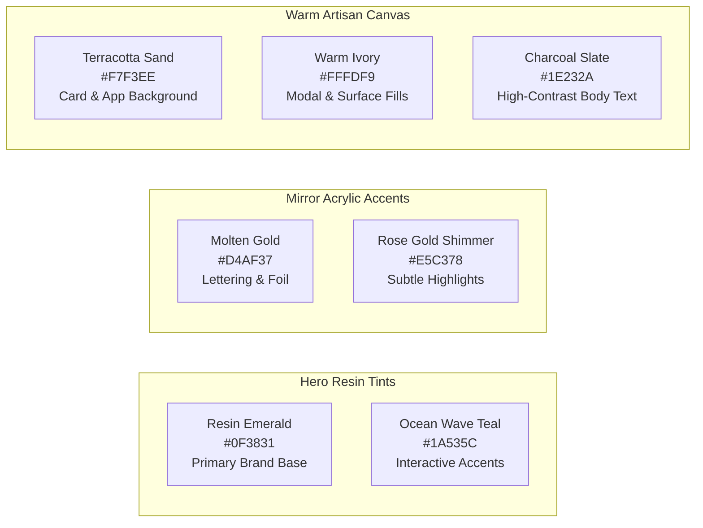

# Artआलय — Frontend UX/UI Design Specification
## Mobile-First, Gen Z Aesthetic Design System & Screen Blueprint

**Document Version:** 1.0.0  
**Author:** Sally (BMad UX Designer Agent 🎨)  
**Collaborators:** Sofia (Product Owner 🎯), Winston (System Architect 🏗️), Mary (Business Analyst 📊)  
**Status:** Approved for Frontend Scaffolding  
**Target Audience:** Gen Z & Young Millennials in India (Aesthetic-First, Mobile-Native, Self-Expressive)  
**Visual Style:** **Desi Modern Luxe & Liquid Glassmorphism**  
**Core Framework:** Next.js 14, Tailwind CSS, Framer Motion, Lucide Icons, Konva.js  

---

## 1. Design Philosophy & The Gen Z Persona

### 1.1 The Audience Mindset
Gen Z and young Indian millennials (ages 18–34) do not buy decor just for utility—**they buy aesthetic self-expression**. They live on Instagram Reels, Pinterest mood boards, and aesthetic YouTube desk setups. 

When shopping on **Artआलय**, they demand:
1. **Instant Visual Gratification:** They will not read long descriptions or fill out complex dropdowns. They want to *see* their name in shiny gold acrylic against swirling ocean resin within 3 seconds of opening the app.
2. **Tactile & Fluid Mobile Gestures:** Smooth bottom-sheet drawers, swipeable horizontal pills, pinch-to-zoom photo croppers, and soft haptic-style button bounces (`active:scale-95`).
3. **Authenticity Over Corporate Starchiness:** They love the "behind-the-scenes artisan reality"—watching ASMR resin demolding videos, learning about natural micro-bubbles, and tracking their piece resting in a 48-hour dust-free cure chamber.
4. **Desi Modernism:** Pride in Indian roots (auspicious Shubh Labh, marigold motifs, Sanskrit mantras, Griha Pravesh blessings) reimagined with sleek contemporary Scandinavian-style minimalism and glass-like finishes.

```
┌─────────────────────────────────────────────────────────────────────────────┐
│                       THE Artआलय AESTHETIC SPECTRUM                         │
├─────────────────────────────────────────────────────────────────────────────┤
│   TRADITIONAL CRAFT                           GEN Z DIGITAL ELEGANCE        │
│   • Raw Teakwood planks         ────►         • Sleek beveled borders       │
│   • Auspicious motifs (Om/Ganesh)────►        • Minimalist raised gold line │
│   • Heavy marigold garlands     ────►         • Preserved dried botanicals  │
│   • Opaque wall paint           ────►         • Translucent frosted glass   │
└─────────────────────────────────────────────────────────────────────────────┘
```

---

## 2. Design System Tokens: Colors, Typography & Radii

### 2.1 Color Palette: "Liquid Jewel & Terracotta Sand"



| Token Name | Hex Value | Tailwind Class | UI Application |
| :--- | :--- | :--- | :--- |
| **brand-emerald** | `#0F3831` | `bg-emerald-950` / `text-emerald-950` | Primary buttons, hero typography, deep brand branding. |
| **brand-teal** | `#1A535C` | `bg-teal-800` / `text-teal-800` | Interactive tags, active tab indicators, ocean resin swatches. |
| **brand-gold** | `#D4AF37` | `bg-amber-500` / `text-amber-500` | 3D mirror lettering simulation, star ratings, CTA glowing rings. |
| **brand-sand** | `#F7F3EE` | `bg-[#F7F3EE]` | Default background across all screens (warm, organic, reduces eye fatigue). |
| **brand-ivory** | `#FFFDF9` | `bg-[#FFFDF9]` | Elevated cards, bottom sheets, navigation bar containers. |
| **brand-charcoal** | `#1E232A` | `text-slate-900` | High-contrast body typography meeting WCAG AAA contrast ratio. |
| **glass-surface** | `rgba(255, 255, 255, 0.75)` | `bg-white/75 backdrop-blur-md` | Floating glassmorphic cards and sticky navigation bars. |

---

### 2.2 Typography Hierarchy: The Dual-Script Harmony
* **Primary Editorial Display Font (Latin):** **Cinzel** or **Playfair Display** (High-contrast, elegant, editorial luxury).
* **Devanagari Brand Display Font:** **Rozha One** or **Noto Serif Devanagari** (Fluid, authentic shirorekha curves for *"Artआलय"* and auspicious motifs).
* **UI & Body Interface Font:** **Plus Jakarta Sans** or **Inter** (Ultra-clean, modern geometric grotesque, optimized for mobile readability at 12px–16px).

```
Hero Heading (36px/42px):  Playfair Display Bold    "Crafted in Resin, Blessed for Home"
Section Title (24px/28px): Plus Jakarta Sans SemiBold "Trending Drops 🔥"
Body Regular (15px/22px):   Plus Jakarta Sans Regular "Every piece is hand-poured..."
Interactive Tabs (13px):   Plus Jakarta Sans Medium  "Substrates • Inclusions • Letters"
Devanagari Wordmark:       Rozha One Display         "Artआलय"
```

---

### 2.3 Radii, Shadows & Glassmorphic Elevation
- **Card Radii:** Ultra-smooth pill shapes and rounded corners:
  - Small pills & chips: `rounded-full`
  - Cards & Modals: `rounded-3xl` (24px)
  - Bottom Drawer Corners: `rounded-t-[32px]`
- **Elevation Tokens:**
  - `shadow-soft`: `0 8px 30px rgba(15, 56, 49, 0.06)` (Floating cards).
  - `shadow-glow`: `0 0 20px rgba(212, 175, 55, 0.25)` (Gold CTA hover/active state).
  - `glass-border`: `border border-white/40` with `backdrop-blur-xl`.

---

## 3. Mobile-First UX Architecture & The Thumb Zone

Because over **90% of Indian D2C social traffic is on smartphones**, the entire interface is architected around **one-handed thumb ergonomics**:

```
┌──────────────────────────────────────┐
│  [Top 15%: Visual Stage & Header]    │  ← Hard to reach (Reserved for Status Bar & Search)
│  • Brand Logo "Artआलय" • Bag Icon    │
├──────────────────────────────────────┤
│  [Middle 40%: The Active Viewport]   │
│  • Interactive Canvas Customizer     │  ← Primary Visual Focus (Pan & Pinch gestures)
│  • High-Res Photographic Preview     │
├──────────────────────────────────────┤
│  [Bottom 35%: The Natural Thumb Zone]│
│  • Horizontal Tool Drawer / Swatches │  ← EASY ONE-HANDED REACH
│  • Typography Inputs & Color Chips   │
├──────────────────────────────────────┤
│  [Bottom 10%: Sticky CTA Bar]        │
│  • [Add to Bag — ₹2,499 ➔]           │  ← Instant Thumb Tap (Fixed position)
└──────────────────────────────────────┘
```

### 3.1 The Sticky Mobile Navigation Bar
When browsing the catalog, a floating glassmorphic bottom navigation dock stays accessible above the bottom home indicator:
* **Tab 1: Home 🌿** (Hero drops, Reels video feed, curated gift guides).
* **Tab 2: Studio 🎨** (Direct jump into the 2D customizer workbench).
* **Tab 3: Bestsellers 🔥** (Filtered view of top-selling pieces and customer photo dumps).
* **Tab 4: My Bag 🛍️** (Slide-up cart drawer with live item count badge).

---

## 4. Screen-by-Screen Interaction Wireframes

### Screen 0: The Unified Auth Modal & Artisan Admin Demo Switcher
* **Visual Presentation:** Center-anchored glassmorphic modal (`bg-brand-ivory/95 backdrop-blur-xl border border-brand-sand shadow-2xl rounded-3xl`).
* **Header:** Artआलय Devanagari monogram `आ`, tab switcher for `[Sign In]` and `[Create Account]`, and close `✕` button.
* **Standard Secure Authentication Form (Zero Public Demo Bypass):**
  - Standard clean login form with zero public credential disclosure or bypass cards.
  - Role (`CUSTOMER` vs `ARTISAN_ADMIN`) is dynamically resolved server/client-side upon credential validation.
* **Standard Form Controls:**
  - Username or Email text field (`focus:ring-2 focus:ring-brand-emerald`).
  - Password field with show/hide eye toggle.
  - Submit button: `[Sign In to Artआलय ➔]` (Brand Emerald with gold icon).
  - Alternative registration switch: *"New to Artआलय? Create an artisan account"*.

```
┌─────────────────────────────────────────────────────────┐
│  [आ] Artआलय Authenticator                          [✕]  │
│  [ Sign In ]                     [ Create Account ]     │
├─────────────────────────────────────────────────────────┤
│                                                         │
│  Username or Mobile Number: [                       ]  │
│  Password:                  [ •••••                 ]  │
│                                                         │
│  [        Sign In to Artआलय Studio ➔        ]           │
│                                                         │
│  Don't have an account? Create an artisan account       │
└─────────────────────────────────────────────────────────┘
```

---

### Screen 1: The Storefront & Asymmetrical Bento Grid
* **Header (Global Sticky Bar):**
  - Left: **Artआलय** dual-script logo and Devanagari monogram badge.
  - Center: Desktop navigation links (`Hero Collection`, `Artisan Story`, `Proof Guarantee`). (Note: The redundant "2D Customizer Studio" link is removed so customers discover products in collections and click customize directly).
  - Right (High-Visibility Auth & Cart Zone):
    - **Logged-Out State:**
      - Prominent text link: **`Sign In`** (`hover:text-brand-gold font-bold`).
      - High-contrast pill button: **`Register`** (`bg-brand-sand border border-brand-emerald text-brand-emerald font-bold rounded-full px-4 py-2 hover:bg-brand-emerald hover:text-white`).
      - Hero CTA: **`Collections`** (`bg-brand-emerald text-white font-bold rounded-full px-5 py-2.5` linking to `/#catalog`).
      - Bag icon with floating badge counter.
    - **Logged-In (Artisan Admin):**
      - Radiant golden-emerald pill badge: **`👑 Artisan Admin ▼`**
      - Dropdown menu options:
        - 📂 **Categories CMS** (`/admin/categories`)
        - 🏷️ **Product Catalog CMS** (`/admin/products`)
        - 🚪 **Sign Out**
        *(Note: Workshop Kanban, Resin Inventory, and Job Sheets are tracked offline by the artist and removed from navigation).*
* **Hero Section ("The Aesthetic Hook & Multi-Craft Showcase"):**
  - **Left Value Proposition Column:**
    - Headline: *"Handmade & Custom Resin Art, Tailored in Discussion with Our Artist"*.
    - Value subtext: Hand-poured with optical clarity non-yellowing resin, carefully sourced durable bases, and complete WhatsApp physical proof approval before curing.
    - CTAs: `[Explore Collections & Customize ➔]` (smooth scrolls to `#catalog`) & `[The Artisan Story]` (smooth scrolls to `#artisan-story`).
    - Trust badges: WhatsApp 100% proof sign-off, Quality Sourced Bases, Free express shipping across India.
  - **Right Interactive Multi-Craft Showcase Card:**
    - Fully dynamic, interactive showcase powered by `useCategoryStore` and `useProductStore`.
    - Features a smooth horizontally-scrollable tab deck displaying all active categories (e.g. `[🌊 Nameplate]`, `[🌸 Bookmark]`, `[🪔 Toran/Shubh Labh]`, `[🔑 Keyrings]`, `[☕ Coasters]`, `[🕒 Wall Clocks]`, `[🍱 Serving Trays]`, `[🕉️ Mantra Wall Art]`, and any admin-added categories).
    - Automatically maps to real catalog products or authentic artisanal presets, complete with high-resolution photography, live starting prices, craft detail badges, and direct `[Customize This Piece ➔]` buttons.
    - Features gentle 6-second auto-rotation with hover pause and automatic smooth center-scrolling for active category tabs.
* **Sticky Occasion Filter Bar:**
  - Horizontal swipeable chips: `[✨ All Drops]`, `[🏡 Housewarming]`, `[🪔 Festive & Mandir]`, `[🎁 Personalized Gifts]`, `[🚗 Car Dashboard]`.
* **The Collections Catalog & Category Selector (`#catalog`):**
  - **Category Filter Pills:** Interactive pill bar allowing customers to filter creations instantly:
    `[✨ All Collections]` • `[🌊 Nameplate]` • `[🔑 Keyrings]` • `[🌸 Bookmark]` • `[🪔 Toran/Shubh Labh]`
  - **Authentic Handcrafted Cards:** Displays primary imagery, title, subtitle, starting price, and `[Customize 🎨]` CTA.
  - **Zero Dummy Ratings:** Artificial numerical star ratings (e.g. ⭐ 4.9) are completely omitted to ensure transparent, authentic artisanal credibility.
* **The Authentic Artisan Story Section (`#artisan-story`):**
  - An intimate, heartfelt section reachable directly from the header's "Artisan Story" navigation link.
  - Features a warm portrait of the small home-based artist working with diverse art mediums:
    - *Story Copy:* "Artआलय was born in a cozy home studio, nurtured by a passionate independent artist driven by the joy of turning raw materials into meaningful, personalized keepsakes. While base substrates like durable MDF plaques and blanks are carefully sourced from trusted outside makers, our artistry lies in selecting the best input materials, inspecting each foundation, and pouring our devotion into every custom detail. From high-grade optical resin that resists yellowing to hand-pressed botanicals and custom typography, the customer is at the center of every piece we create."
  - Highlight cards: `[🏡 100% Home Studio Poured]`, `[✨ Thoughtfully Sourced & Inspected]`, `[❤️ Customer at the Center]`.

---

### Screen 2: The Polymorphic 2D Customizer Studios (Mobile Viewport)

Artआलय tailors the visual stage and controls drawer specifically to the geometry and tactile craft of each product category:

#### Screen 2.0: 2D Customizer Studio Selection Hub (`/customize`)
Customers primarily launch customization directly by clicking **"Customize"** on any piece in the handcrafted collections catalog (`/#catalog`). When visiting `/customize`, they arrive at the Studio Selection Hub:
* **Header & Mission:** *"Interactive Artisan Customizer Studios — Choose Your Canvas to Begin"*.
* **Interactive Category Pills:** Filter customizable pieces across `All Studios`, `Nameplate`, `Keyrings`, `Bookmark`, and `Toran/Shubh Labh`.
* **Collection Bento Cards:** Each piece displays photography, category badge, aspect ratio indicator (`16:10`, `1:1`, `4:10`, `Dual Discs`), starting price, and an active `[Customize Piece 🎨]` action button navigating directly to its category customizer.

#### Screen 2.0B: Photographic Base Live 2D Artisan Preview Architecture (Zero Blueprint Mode)
Across all customizer screens (`/customize/[slug]`), the visual stage renders the **original product photograph** (from `productImage`) as the high-fidelity substrate:
- **Zero Blueprint Mode:** Technical blueprint/wireframe modes have been decommissioned across all categories. Only authentic artisan photo previews are displayed.
- **Base Layer:** The authentic product photograph uploaded in CMS or catalog piece.
- **Dynamic Overlays:** Real-time CSS and SVG composite layers representing selected customizations (3D acrylic typography, sacred emblems, pressed botanical flora, hardware finishes, hanging brass bells, and LED halo backlighting).
- **Floating Status Pills:** Interactive badges on canvas indicate when custom requirements and reference photos are attached.
- **Cart Thumbnail Guarantee:** When added to the bag, the thumbnail photo directly references the selected product's `imageUrl` so the cart drawer accurately mirrors the chosen creation.

#### Screen 2A: Bespoke Nameplate Studio (`/customize/bespoke-teakwood-nameplate`)
```
┌──────────────────────────────────────┐
│  ← Back    Bespoke Name Plate   [ ? ]│
├──────────────────────────────────────┤
│                                      │
│     [ ORIGINAL PRODUCT PHOTOGRAPH ]  │  ← Real Product Photo Base
│      ┌─────────────────────────┐     │  • Pristine grain & resin substrate
│      │                         │     │    (No fake text printed by default)
│      │   [User's Family Name]  │     │  • 3D mirror gold acrylic letters
│      │   [Subtext / House No.] │     │  • Pure Artisan Photo Preview
│      └─────────────────────────┘     │  • Floating "Reference Attached" chip
│   [📷 Reference Attached] [LED Aura]  │  • Floating "Requirements Added" chip
│                                      │
├──────────────────────────────────────┤
│  1. TEXT TO BE PRINTED:              │  ← Single-Pane Streamlined Controls
│  Line 1: [ Enter family name (0/20) ]│
│  Line 2: [ Enter house no.   (0/28) ]│
│                                      │
│  2. DESCRIBE YOUR REQUIREMENTS:      │  ← Free-Text Requirements Input
│  ┌──────────────────────────────────┐│  • Preferred colors, froth style,
│  │ e.g. Deep ocean navy with golden ││    or custom themes (1000 char max)
│  │ sand shimmer, 2 hooks on back... ││  • Replaces rigid color swatches
│  └──────────────────────────────────┘│  • Floating status indicator on canvas
│                                      │
│  3. CHOOSE SIZE:                     │
│  ● 12"x8" Standard  ○ 16"x10" (+₹500)│
│  ○ 18"x12" Executive (+₹900)         │
│                                      │
│  4. LED INCLUSION:                   │
│  [X] 12V Warm LED Backlighting (+₹799│
│                                      │
│  5. REFERENCE PHOTO FOR WHATSAPP:    │
│  [ ⬆ Upload Inspiration Photo / Pin ]│
│  💬 Artisan WhatsApp Consultation:   │
│  "Review with artist before pouring" │
│  [ Chat on WhatsApp with Artist ➔ ]  │
├──────────────────────────────────────┤
│  ₹2,499 (GST Incl.)  [ Add to Bag ➔ ]│  ← Sticky Bottom Bar
└──────────────────────────────────────┘
```

#### Screen 2B: Crystal Monogram Keyring Studio (`/customize/crystal-initial-keyring`)
```
┌──────────────────────────────────────┐
│  ← Back    Monogram Keyring     [ ? ]│
├──────────────────────────────────────┤
│                                      │
│         [ 1:1 SQUARE CANVAS ]        │  ← Top 50% Viewport
│               ╭─────╮                │  • Polished Brass Gold Key Loop & Chain
│               │ (O) │ [Key Ring]     │  • 3D Crystal Monogram Letter
│               ╰──┬──╯                │  • Suspended botanicals / gold foil
│             ┌────┴────┐              │  • Optional laser-etched circular tag
│             │    K    │              │  • Floating "Reference Attached" chip
│             └─────────┘              │  • Floating "Requirements Added" chip
│   [📷 Reference Attached] [Req Pill] │
│                                      │
├──────────────────────────────────────┤
│  1. MONOGRAM INITIAL & TAG:          │  ← Single-Pane Streamlined Controls
│  Select Initial:                     │
│  [ A ] [ B ] [ C ] ... [ Z ]         │  ← A-Z Letter Selector
│  Personalized Tag (+₹99 tentative):  │
│  [ Enter name/initials (0/10) ]      │  ← Clean, no forced "Priya" default
│                                      │
│  2. DESCRIBE YOUR REQUIREMENTS:      │  ← Free-Text Requirements Input
│  ┌──────────────────────────────────┐│  • Custom colors, flakes, styling
│  │ e.g. 24K gold flakes with soft   ││    ideas, charm desires (1000 char max)
│  │ blush tint and floral accents... ││  • Replaces rigid color swatches
│  └──────────────────────────────────┘│  • Floating status indicator on canvas
│                                      │
│  3. REFERENCE PHOTO FOR WHATSAPP:    │  ← Reference photo for WhatsApp discussion
│  [ ⬆ Upload Sample / Initial Sketch ]│
│  💬 Direct WhatsApp Artist Consult   │
│  [ Chat on WhatsApp with Artist ➔ ]  │
├──────────────────────────────────────┤
│  Tentative Est. ₹399                 │  ← Sticky Bottom Bar
│  Pay ₹199 Token Deposit Today        │  • 50% Token Refund Guarantee
│  [ Add to Bag • Pay ₹199 Token ➔ ]   │
└──────────────────────────────────────┘
```

#### Screen 2C: Streamlined Pressed Botanical Bookmark Studio (`/customize/pressed-floral-bookmark`)
```
┌──────────────────────────────────────┐
│  ← Back    Artisan Bookmark     [ ? ]│
├──────────────────────────────────────┤
│                                      │
│        [ 4:10 PORTRAIT CANVAS ]      │  ← Top 50% Viewport
│                 [Silk Tassel]        │  • Hanging golden silk tassel loop
│                 ║ ~~~~~~             │  • 5.5" x 1.2" Optical resin strip
│               ┌─╨─┐                  │  • Selected resin tint gradient
│               │ 🌸│ Natural Flowers  │  • Optional pressed flora blooms
│               │ 🍃│ (If selected)    │  • Name in elegant serif font
│               │                      │    (Only renders if typed; no
│               │ [Recipient Name]     │     forced "Your Name" default)
│               └───┘                  │  • Floating "Reference Attached" chip
│   [📷 Reference Attached] [Req Pill] │  • Floating "Requirements Added" chip
│                                      │
├──────────────────────────────────────┤
│  1. NAME PERSONALIZATION:            │  ← Focused Artisan Decisions
│  Add Name Personalization? (+₹49)    │
│  (●) Yes (+₹49)       ( ) No (+₹0)   │
│  Recipient Name:                     │
│  [ Enter recipient name (0/24) ]     │  ← Only shown if Yes
│                                      │
│  2. FLOWER INCLUSION:                │
│  Include Natural Pressed Flowers?    │
│  (●) Yes, include flowers  ( ) Plain │  ← Toggles flora layer
│                                      │
│  3. DESCRIBE YOUR REQUIREMENTS:      │  ← Free-Text Requirements Input
│  ┌──────────────────────────────────┐│  • Preferred tints, botanical styles,
│  │ e.g. Wild violet flowers with    ││    gifting notes (1000 char max)
│  │ subtle gold flecks along edge... ││  • Replaces rigid color swatches
│  └──────────────────────────────────┘│  • Floating status indicator on canvas
│                                      │
│  4. REFERENCE PHOTO FOR WHATSAPP:    │
│  [ ⬆ Upload Bookmark / Flower Ref ]  │
│  💬 Direct WhatsApp Artist Consult   │
│  [ Chat on WhatsApp with Artist ➔ ]  │
├──────────────────────────────────────┤
│  ₹499 (GST Incl.)    [ Add to Bag ➔ ]│  ← Sticky Bottom Bar
└──────────────────────────────────────┘
```

#### Screen 2D: Sacred Toran & Shubh Labh Studio (`/customize/auspicious-shubh-labh-pair`)
```
┌──────────────────────────────────────┐
│  ← Back    Toran & Shubh Labh   [ ? ]│
├──────────────────────────────────────┤
│                                      │
│        [ DUAL GEODE ENTRANCE CANVAS ]│  ← Top 50% Viewport
│         ┌──────────┐    ┌──────────┐ │  • Genuine artisan studio piece
│         │ 💎शुभ 💎 │    │ 💎लाभ 💎 │ │  • Authentic crystalline geode rim
│         └────┬─────┘    └────┬─────┘ │  • 3D Mirror Gold Calligraphy
│             (🔔)            (🔔)     │  • Hanging traditional bells
│   [📷 Reference Attached]            │  • Live requirements & reference pill
│                                      │
├──────────────────────────────────────┤
│  1. DESCRIBE YOUR REQUIREMENTS:      │  ← Free-Text Consultation Drawer
│  ┌──────────────────────────────────┐│  • Custom colors & dimensions
│  │ e.g. Emerald green theme with    ││  • Specific blessings (Shubh Labh)
│  │ brass temple bells for 3.5ft door││  • Mandir or doorway specs
│  └──────────────────────────────────┘│  • 1000 character limiter
│                                      │
│  2. ATTACH REFERENCE PHOTO:          │
│  [ ⬆ Upload Entrance / Mandir Photo ]│  • Optional PNG/JPG/WEBP (up to 5MB)
│                                      │
│  💬 1-on-1 WhatsApp Consultation     │
│  [ Chat on WhatsApp with Artist ➔ ]  │
├──────────────────────────────────────┤
│  ₹1,299 (GST Incl.)  [ Submit & WA ➔]│  ← Sticky Bottom Bar
└──────────────────────────────────────┘
```

#### Detailed Customizer Micro-Interactions:
1. **Typing Experience:** As the user types their family name or quote, the 3D acrylic or laser-etched letters appear on the canvas in real time with smooth kerning.
2. **Requirements Input & Live Floating Pills:** As the user writes into the requirements free-text field or attaches a reference image, real-time floating indicator badges appear on the photographic canvas, confirming that custom details have been attached for WhatsApp consultation.
3. **Hardware & Accents Toggle:** Switching between brass gold, rose gold, or silk tassel threads updates the hanging hardware elements instantly.
4. **Dynamic Price Bar:** Surcharges (e.g. custom laser quote +₹99, mini charm +₹49, LED backlight +₹799) dynamically roll up the sticky bottom price counter with zero lag.

---

### Screen 3: Product Details Page (PDP) & Aesthetic Trust Engine
* **Media Carousel:** High-res edge-to-edge swipeable gallery + 1 short video reel showing the physical piece catching natural sunlight.
* **Merchandising Tag:** Badges rendered with glowing borders (`👑 Masterpiece` in royal emerald; `🔥 Bestseller` in molten amber).
* **Transparent Lead Time Card:**
  - *"Handcrafted with Love — 5 to 7 Days Crafting & Curing Time"*.
  - An animated hourglass icon pulsing softly.
* **"The Artisan's Touch" Disclosure Card:**
  - Expandable accordion explaining that every fluid swirl and microscopic bubble is an authentic signature of hand-poured liquid epoxy resin.
* **Resin Care & Longevity Sheet:**
  - 1-tap drawer showing 3 simple care icons: *Clean with microfiber cloth*, *Keep away from harsh UV outdoor rays*, *Wipe with mild water*.
* **Verified Customer Video & Photo Dumps (Social Proof):**
  - UGC (User Generated Content) carousel displaying real customer photos of the item hanging on their front doors, parked on car dashboards, or resting in books.
  - Overall 4.9/5 Star Rating with 1-tap filter for *"Photos Only"*.

---

### Screen 4: 1-Tap Cart & Gifting Suite Drawer
* **Persistent Cart Slide-Over:** Slides up smoothly from the bottom of the screen.
* **Customizer State Preview:** Each cart item displays:
  - Customizer-generated 300-DPI preview thumbnail.
  - Full configuration badge: *"Teakwood • Emerald Geode • Royal Serif • The Sharmas"*.
  - `[✏️ Edit Design]` button that instantly re-opens the customizer with the exact saved settings.
* **Free Express Shipping Progress Meter:**
  - Animated bar showing: *"Add ₹101 more to unlock FREE Express Delivery! 🚚"* (Free above ₹999).
* **The Gifting Toggle (`[🎁 This is a Gift]`):**
  - Expands an aesthetic terracotta greeting card editor.
  - Customer types their personalized message in an elegant cursive preview font.
  - Checkbox: *"Conceal product price on physical package slip"*.

---

### Screen 5: Frictionless Indian D2C Checkout Flow
* **Step 1: Contact & Delivery Address:**
  - 10-digit Indian Mobile Phone input with instant OTP auto-read (WebOTP API).
  - PIN code field with auto-population of City and State in <200ms.
  - Checkbox: *"Billing address matches shipping address"*.
* **Step 2: Flexible Delivery Timeline & Target Date (Optional):**
  - Informational card: *"Each product delivery lead time varies based on order backlog, artist availability, and inventory status. The actual delivery date will be confirmed by the artist when designs are approved over WhatsApp."*
  - Checkbox toggle: *"I need this creation by a specific target date (e.g. Wedding, Griha Pravesh, Anniversary)"*.
  - When checked, reveals Target Date picker (`neededByDate`) and Reason field (`neededByReason`).
* **Step 3: Payment Method (Token Booking Deposit & WhatsApp Consultation):**
  - **Tentative Pricing & Token Model:** All catalog and customizer prices are tentative estimates. The final price is agreed upon only after WhatsApp discussion with the artist.
  - **Option A (Recommended):** `[Pay ₹199 Token Booking Deposit via UPI]` (GPay, PhonePe, Paytm, Cards via Razorpay). Initiates direct WhatsApp consultation with the lead artisan.
  - **Option B:** `[Prepay Full Tentative Estimate via UPI]` (Fully refundable or adjustable upon mutual agreement).
  - **50% Refund Guarantee:** Reassuring guarantee card displayed across checkout and order confirmation:
    > *"In case the final price or design is not agreed upon later during WhatsApp discussion with the artist, 50% of the token amount will be returned promptly."*

---

### Screen 6: Order Status & Direct Artisan WhatsApp Consultation (`/track/[orderNumber]`)

Transparent, reassuring consultation hub where customer and artisan collaborate directly over WhatsApp to agree upon delivery date, design revisions, and final price:

```
┌────────────────────────────────────────────────────────┐
│  Order #ART-2026-1049                         [Share 📤]│
│  "Bespoke Natural Wood Nameplate"                       │
├────────────────────────────────────────────────────────┤
│  🟢 WhatsApp Consultation Active                       │
│  "Connect directly with our artisan on WhatsApp to     │
│   discuss custom preferences, agree upon the final     │
│   price, and confirm the mutually agreed delivery date"│
│                                                        │
│  [ 💬 Chat with Artisan on WhatsApp (Date & Price) ]   │
├────────────────────────────────────────────────────────┤
│  💳 TENTATIVE PRICING & TOKEN DEPOSIT                  │
│  • Token Deposit Paid Now: ₹199                        │
│  • Estimated Remaining Balance: ₹2,300 (Tentative)     │
│  • Final Price: Finalized only after design approval   │
│                                                        │
│  🛡️ 50% TOKEN REFUND GUARANTEE                         │
│  If design or final price is not agreed upon during    │
│  WhatsApp consultation, 50% of the token deposit will  │
│  be promptly refunded.                                 │
├────────────────────────────────────────────────────────┤
│  🚚 COURIER TRANSIT & DELIVERY TRACKING                │
│  • Shiprocket Courier Tracking (when dispatched)       │
│  • Free Transit Breakage Replacement Guarantee         │
└────────────────────────────────────────────────────────┘
```

---

### Screen 6.1: Customer Account Hub & "My Orders" Tracker (`/account/orders`)

Dedicated portal for logged-in shoppers to view active handcrafted pieces, connect with the artisan, and access GST tax invoices:

```
┌────────────────────────────────────────────────────────┐
│  👤 Priya Sharma                                       │
│  priya@example.com • +91 98111 22334 • Member Since '26│
│                                                        │
│  [All Orders (2)]    [In Discussion / Production (1)]  [Delivered (1)]│
├────────────────────────────────────────────────────────┤
│  Order #ART-2026-1049                    ₹3,798        │
│  Placed on: Oct 29, 2026 • 1 Item                      │
│                                                        │
│  [🖼️] Bespoke Natural Wood & Ocean Resin Nameplate     │
│       Qty: 1 • Size: 16"x10" • 12V LED Halo            │
│       Inscription: "Sharma Residence • Villa 42"       │
│                                                        │
│  Stage Status: 🟡 In Discussion & Workshop Production  │
│  (Delivery Date & Price to be finalized on WhatsApp)   │
│                                                        │
│  [ 🔍 Order Status & Details ]  [ 📄 View Tax Invoice ]│
│  [ 💬 Chat on WhatsApp (Date & Price) ]                │
├────────────────────────────────────────────────────────┤
│  Order #ART-2026-1050                      ₹448        │
│  Placed on: Oct 31, 2026 • 1 Item                      │
│                                                        │
│  [🖼️] Crystal Monogram Resin Letter Keyring            │
│       Qty: 1 • Letter 'P' • Ocean Breeze               │
│                                                        │
│  Stage Status: 🟢 Delivered                            │
│                                                        │
│  [ 🔍 Order Status & Details ]  [ 📄 View Tax Invoice ]│
└────────────────────────────────────────────────────────┘
```

---

### Screen 7: Artisan Catalog CMS & Price Management Suite (`/admin/products`)

* **Visual Style:** High-density luxury workstation interface matching Artआलय brand tokens (`bg-brand-ivory`, `border-brand-sand`, `text-brand-emerald`).
* **Category-First Selection Bar (Horizontal Pill Deck):**
  - Interactive category pills with live count badges:
    `[🌿 All Creations (4)]` • `[🌊 Nameplate (1)]` • `[🔑 Keyrings (1)]` • `[🌸 Bookmark (1)]` • `[🪔 Toran/Shubh Labh (1)]`
  - Active pill highlighted in `bg-brand-emerald text-white shadow-sm`.
* **Streamlined Pricing & Product Lifecycle Actions:**
  - **Inline Price Editing Only:** The redundant "Edit Price" button in the actions column is removed. Clicking the pencil icon `✎` or price text in the Price column activates the inline numeric input field (`[ ₹ 2499 ]`) with instant save (`Enter` or `✓`) and cancel (`Esc` or `✕`).
  - **1-Click Interactive Category Reassignment:** The Category table cell contains an interactive dropdown pill (e.g. `[🌊 Nameplate ▾]`). Clicking opens a 1-click popover to reassign the product to any of the 4 standardized categories (*Nameplate*, *Keyrings*, *Bookmark*, *Toran/Shubh Labh*) with instant persistence.
  - **Removal of Classification Column:** The redundant "Classification" column (`Customizable` vs `Ready to Ship`) is eliminated from the table to reduce visual clutter.
  - **Removal of Fixed Cure Time & Lead Time:** The "Lead Time" column is eliminated from the CMS table and catalog cards, and the "Curing Days" input is removed from the Add New Creation Modal. Delivery timelines are dynamically confirmed with the customer by the artist upon WhatsApp design approval.
  - **1-Click Deletion Safeguard:** Each row includes a `[🗑️ Delete]` action button. Clicking prompts an alert dialog: *"Are you sure you want to delete [Product Title]?"* to prevent accidental removals.
  - **Add New Creation Modal with Local Image Browse:** Triggered via `[+ Add New Creation]` in the top header bar, allowing admins to add title, subtitle, category, price, customizable toggle, and choose or browse imagery without defining cure time.
    - **Local Image Browse Dropzone & 5 MB Optimization Modal:** Features dual modes: `[💻 Browse from Device]` and `[✨ Studio Presets & URL]`. In local mode, provides a styled drag-and-drop zone with a native system file selector trigger. If a selected image exceeds the 5.00 MB upper limit, a confirmation modal (*"Image Exceeds 5 MB Limit"*) requests permission to compress the file. Upon confirmation (`[Compress & Upload]`), client-side canvas optimization progressively downscales and compresses the image to strictly satisfy the 5 MB ceiling while preserving retina clarity before sending to `/api/admin/upload`. Displays an instant preview tile showing thumbnail, filename, size in KB, and replace controls.
  - **Instant Storefront Synchronization:** Any creation added, edited, or deleted in CMS immediately updates both the Admin table and the public Collections bento grid via shared reactive state (`useProductStore`).

```
┌────────────────────────────────────────────────────────────────────────┐
│  Artisan Merchandising CMS                         [+ Add Creation 🎨] │
│  Product Catalog & Badge Manager           [Manage Categories (9) ➔]   │
├────────────────────────────────────────────────────────────────────────┤
│  Category Filter:                                                      │
│  [🌿 All (4)]  [🌊 Nameplate (1)]  [🔑 Keyrings (1)]  [🌸 Bookmark (1)] │
│  [☕ Coasters (0)]  [🕒 Wall Clocks (0)]  [🍱 Trays (0)]  [💍 Trinkets] │
├────────────────────────────────────────────────────────────────────────┤
│  ITEM & TITLE           CATEGORY (1-Click)   BADGE     PRICE   ACTIONS │
│  --------------------------------------------------------------------  │
│  [img] Bespoke Ocean    [🌊 Nameplate ▾]     [🔥 Best] ₹2,499  [👁️] [🗑️]│
│        Natural Wood                                                    │
│                                                                        │
│  [img] Monogram Letter  [🔑 Keyrings ▾]      [✨ New]   ₹399   [👁️] [🗑️]│
│        Keyring                                                         │
└────────────────────────────────────────────────────────────────────────┘
```

---

### Screen 7D: Category Management CMS & Taxonomy Engine (`/admin/categories`)

* **Visual Style:** Luxury administrative curation studio matching Artआलय brand tokens (`bg-brand-ivory`, `border-brand-sand`, `text-brand-emerald`).
* **KPI Summary Header:**
  - `[📂 Total Categories: 9]` • `[✨ Custom Created: 5]` • `[💎 Default Core: 4]` • `[📦 Catalog Products: 4]`
* **Category Bento Grid & Actions:**
  - Each category card presents:
    - Large emoji icon container (e.g. `☕`, `🕒`, `🍱`, `💍`, `🕉️`).
    - Title and descriptive craft tagline.
    - Code identifier badge (e.g. `ID: COASTERS`) and core vs. custom pill.
    - Active product count pill with a 1-click shortcut to filter products in the catalog CMS (`/admin/products?category=...`).
    - Quick `[Edit ✏️]` and `[Delete 🗑️]` action buttons.
* **Interactive Category Creation / Editing Modal:**
  - **Category Display Name:** Auto-capitalizes and trims (e.g. "Serving Trays").
  - **Unique Identifier (Code):** Auto-generates clean uppercase identifier (e.g. `SERVING_TRAYS` or `TRAYS`) with override support.
  - **Emoji Quick-Picker:** 20+ preset artisanal emojis (☕, 🕒, 🍱, 💍, 🕉️, 🌿, 💎, 🌸, 🌊, 🪔, 👑, ✨, 🎨, 🕯️, 🧿, 🎁, etc.) plus a custom emoji text field.
  - **Craft Description:** Subtitle detailing the substrate and finish style.
  - **Live Card Preview:** Displays a real-time reactive preview of how the category card will look before persisting to server disk.
* **Deletion Safeguard:**
  - The system checks product assignments. If active catalog products belong to that category, deletion is prevented with an informative alert dialog: *"Cannot delete category '[Title]'. 2 active products are currently assigned to it. Please reassign those creations first."*
* **Dynamic Storefront Propagation:**
  - All categories saved in `/admin/categories` immediately reflect across:
    - **Storefront Collections Pill Deck (`/`):** Horizontally scrollable pill deck with live item counts.
    - **Interactive Studio Selection Deck (`/customize`):** Dynamic studios with customizer aspect ratio support.
    - **Product Catalog CMS (`/admin/products`):** Interactive category filter bar, 1-click table cell reassignment popovers, and the "+ Add New Creation" modal dropdown.

```
┌────────────────────────────────────────────────────────────────────────┐
│  Artआलय Category Taxonomy CMS                   [+ Add New Category 📂]│
│  Manage Storefront Collections & Customizer Studios                    │
├────────────────────────────────────────────────────────────────────────┤
│  [Total: 9 Categories]  [Custom Added: 5]  [Active Catalog Mapped: 4]  │
├────────────────────────────────────────────────────────────────────────┤
│  Search Categories: [ Search category title, emoji, or ID...       🔍 ]│
├────────────────────────────────────────────────────────────────────────┤
│  ┌─────────────────────────┐  ┌─────────────────────────┐              │
│  │ ☕ Coasters & Slices    │  │ 🕒 Wall Clocks          │              │
│  │ Luxury geode drink      │  │ Statement Roman numeral │              │
│  │ coasters with 24K edges │  │ crystal resin clocks    │              │
│  │ [ID: COASTERS] [0 Prods]│  │ [ID: WALL_CLOCKS] [0]   │              │
│  │ [Edit ✎]     [Delete 🗑️]│  │ [Edit ✎]     [Delete 🗑️]│              │
│  └─────────────────────────┘  └─────────────────────────┘              │
│  ┌─────────────────────────┐  ┌─────────────────────────┐              │
│  │ 🍱 Serving Trays        │  │ 💍 Trinket Dishes       │              │
│  │ Hand-poured charcuterie │  │ Delicate ring holders & │              │
│  │ & vanity platters       │  │ bedside jewelry dishes  │              │
│  │ [ID: TRAYS]    [0 Prods]│  │ [ID: TRINKETS] [0 Prods]│              │
│  │ [Edit ✎]     [Delete 🗑️]│  │ [Edit ✎]     [Delete 🗑️]│              │
│  └─────────────────────────┘  └─────────────────────────┘              │
└────────────────────────────────────────────────────────────────────────┘
```

---

## 5. Micro-Interactions, Motion Design & Delight Points

| Trigger | Motion / Interaction Behavior | Emotional Impact |
| :--- | :--- | :--- |
| **Tap Swatch Chip** | Swatch expands by 1.1x with a golden ring; canvas resin layer cross-fades with liquid wave shader. | Tactile, responsive, satisfying. |
| **Type Custom Name** | Letters pop onto canvas with spring dynamics (`damping: 15, stiffness: 200`). | Immediate ownership of creation. |
| **Pinch-to-Crop Photo** | Smooth rubber-band panning with circular masking guide and instant DPI quality badge update. | Professional, effortless control. |
| **Order Placed** | Full-screen gentle particle burst of molten gold flakes; order number rendered in Devanagari calligraphy. | Celebration, emotional reward. |
| **Active Button Tap** | Button compresses slightly (`scale: 0.96`) with soft shadow contraction. | Tactile physical button feel. |

---

## 6. Accessibility (WCAG 2.1 AA) & Performance Guardrails

1. **Touch Target Sizing:** Every button, chip, and input target has a minimum tappable area of **$48 \times 48\text{ px}$** with at least $8\text{ px}$ spacing between interactive elements to prevent mis-clicks.
2. **Color Contrast Compliance:** All body text (`#1E232A`) against background (`#F7F3EE`) achieves a contrast ratio of **12.4:1**, far exceeding the WCAG AAA threshold of 7:1. Gold accents on white backgrounds are paired with dark outlines or drop-shadows for high legibility.
3. **Screen Reader Accessibility:** The customizer canvas includes an off-screen accessible live region (`aria-live="polite"`) announcing: *"Selected Natural Wood base with Ocean Wave resin."*
4. **Performance Budgets:**
   - Total CSS bundle: < 45 KB (Tailwind optimized).
   - Canvas Swatch WebP images: < 35 KB each.
   - Initial First Contentful Paint (FCP): < 1.2s on mobile 4G.
   - Interaction to Next Paint (INP): < 50ms.

---

## 7. UX Designer Sign-Off (Sally 🎨)

This Frontend UX/UI Design Specification bridges the gap between Indian cultural artisanal pride and Gen Z digital elegance. Every screen is optimized for mobile thumb ergonomics, fast visual gratification, and frictionless purchasing.

**Ready for Component Implementation:** Sally (BMad UX Designer 🎨)

